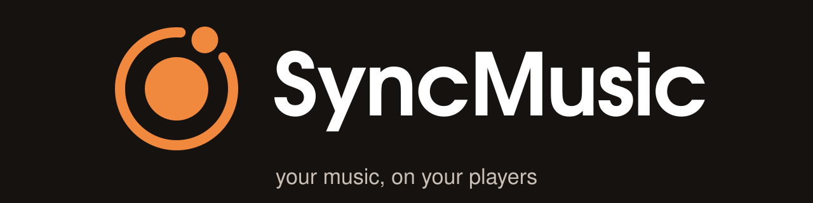

# SyncMusic



[](LICENSE)

SyncMusic keeps portable music players in sync with your media server. It copies music, podcasts and audiobooks
from your **libraries** onto your **devices**, converting and tagging each file on the way, and it sends what you
listened to on the device (play counts, ratings, podcast/audiobook positions) back to the library.

- **Libraries**: [Navidrome](https://www.navidrome.org/) (Subsonic API), a plain **folder** of audio files, and
  [Audiobookshelf](https://www.audiobookshelf.org/) (audiobooks and podcasts), and
  [Jellyfin](https://jellyfin.org/) (movies and episodes, one way to the player; beta).
- **Devices**: iPods with Apple's firmware, Rockbox players, HiBy R1, USB flash drives and memory cards, FTP
  servers and SMB shares, Android players over MTP (beta) - see [Supported devices](#supported-devices).
- **Rules** decide what goes onto a device. They are compatible with Navidrome smart playlists (`.nsp`), can be
  written in JSON or YAML or built in the UI, and are saved as **templates** shared by several devices. Every library
  comes with default templates (e.g. "All music", "Favourites", "Unfinished books"); a device gets templates (and
  optionally its own rules), and **the templates decide which libraries it draws from**.
- **Processors** run per device: transcode (e.g. FLAC → ALAC/AAC/MP3), retag, covers, lyrics (`.lrc`).
- **Reverse sync**: what you played, rated, favourited or where you stopped in a book goes from the device back to
  the library - see [Supported libraries](#supported-libraries) for what each library takes back.

It is one Python application: a daemon with a REST API, a web UI that also works on a phone, an optional desktop
window, and a command line client. It runs on Linux (x86_64 and arm64, e.g. a Raspberry Pi).

## Contents
- [Supported libraries](#supported-libraries)
- [Supported devices](#supported-devices)
- [Requirements](#requirements)
- [Installation](#installation) - one-line service install, single-file binary, Docker, from source
- [Quick start](#quick-start)
- [Run modes](#run-modes)
- [Your first device](#your-first-device)
- [Configuration and data](#configuration-and-data)
- [Command line](#command-line)
- [Building the single-file binaries](#building-the-single-file-binaries)
- [Running the tests](#running-the-tests)
- [Troubleshooting](#troubleshooting)
- [Safety notes](#safety-notes)
- [Roadmap](#roadmap)
- [Documentation](#documentation)

## Supported libraries
| Library | What it provides | Reverse sync (device → library) |
|---|---|---|
| [Navidrome](https://www.navidrome.org/) - other Subsonic servers (Gonic, Airsonic, Ampache, …) speak the same API but are untested | music, playlists (Navidrome has no podcasts; podcasts come only from Subsonic servers that serve them) | **yes**: play counts (scrobbles), ratings, favourites |
| [Audiobookshelf](https://www.audiobookshelf.org/) | audiobooks, podcasts, collections | **yes**: listening positions (progress, finished) |
| Folder - local, on an SMB share or on an FTP server | music, podcasts, audiobooks, video files | no (files only) |
| [Jellyfin](https://jellyfin.org/) | movies and episodes - **beta** | no: one way, to the player |
| Plex | - | not available in this version |

What a device reports back depends on the device: iPods send play counts, ratings and audiobook/podcast bookmarks;
Rockbox players play counts (from the playback log) and ratings; the HiBy R1 play counts, favourites and positions.
USB drives, FTP/SMB folders and Android players have no listening data to send back.

## Supported devices
| Device | Status | Notes |
|---|---|---|
| iPod Classic (6G, 7G), iPod video (5G/5.5G), iPod 4G/photo, iPod mini, iPod nano 1G–4G | supported | Apple's firmware, through [pygpod](https://pypi.org/project/pygpod/); music, podcasts, audiobooks, covers, video on video-capable models; play counts, ratings and bookmarks come back |
| iPod nano 5G | untested, probably not working | it reads its library from Apple's SQLite databases, which pygpod does not write yet, and its database checksum (hash72) needs a `HashInfo` file that only an earlier iTunes sync leaves on the iPod |
| iPod nano 6G and 7G, iPod touch, iPhone | not supported | refused: their database checksum cannot be written |
| Rockbox players (iPods with Rockbox, other Rockbox targets) | supported | music only; play counts from Rockbox's playback log |
| HiBy R1 (SonixOS) | supported | reboot the player after a sync so it shows the new music |
| USB flash drives and memory cards | supported | vfat, exFAT, ext4, NTFS |
| FTP server, SMB share | supported | a folder on a network player, streamer or NAS |
| Android players and phones (MTP) | **beta** | tested on an Android handheld only; no Android DAP was available for testing yet |

Details per device: [docs/04-devices.md](docs/04-devices.md).

## Requirements
- Linux with udev, glibc ≥ 2.28. Python ≥ 3.12 and [uv](https://docs.astral.sh/uv/) for a source install (the
  single-file binaries bring their own Python).
- System tools (Debian / Raspberry Pi OS / Ubuntu package names):
  ```sh
  sudo apt install ffmpeg util-linux fdisk parted udev dosfstools exfatprogs e2fsprogs ntfs-3g sg3-utils eject rsync
  # optional: udisks2 (power a disk off after eject)
  # desktop window only: libsecret-1-0 libegl1 libgl1 libgles2 and a Chromium-based browser
  ```
- Mounting and formatting devices needs root. The systemd service runs as root; when you run SyncMusic as a
  normal user it calls the block-device tools through `sudo -n`, so that user needs passwordless sudo for them.

## Installation

Releases: [github.com/Bionded/SyncMusic/releases](https://github.com/Bionded/SyncMusic/releases). Besides the
stable releases, every change on `main` is published as a **beta** pre-release (`v0.2.1-3`: build 3 on the way to
0.2.1).

### One line (systemd service)
```sh
curl -fsSL https://raw.githubusercontent.com/Bionded/SyncMusic/main/install.sh | sudo bash
```
It downloads the web binary for your CPU (x86_64 or aarch64) from the newest stable release, checks it against the
release's `SHA256SUMS` and installs it as the `syncmusic` service: open `http://<host>:8765/`. Options after
`sudo bash -s --`: `--beta` (the newest beta instead), `--version X` (e.g. `0.2.0`),
`--port N`, `--user NAME` (a normal user that may use the devices), `--install-deps` (the system tools above, apt or
dnf), `--uninstall [--purge]`. Running it again upgrades in place; the app can also update itself (Settings →
Updates, channel *Stable* or *Beta*).

### One folder, no root
```sh
curl -fsSL https://raw.githubusercontent.com/Bionded/SyncMusic/main/install.sh | bash -s -- --dir ~/syncmusic --port 8765
~/syncmusic/run.sh
```
Program, config, data, cache and logs all go into that folder; no service is set up, you start it by hand.
Details in [docs/02-installation.md](docs/02-installation.md#in-one-folder-without-a-service).

### Single-file binary
Download `syncmusic-web-<version>-linux-<arch>` (web UI) or `syncmusic-desktop-<version>-linux-<arch>` (its own
window) and `SHA256SUMS` from the [release](https://github.com/Bionded/SyncMusic/releases), then:
```sh
sha256sum -c --ignore-missing SHA256SUMS
chmod +x syncmusic-web-0.2.0-linux-x86_64
./syncmusic-web-0.2.0-linux-x86_64                # web UI on http://localhost:8765/, Ctrl+C stops it
./syncmusic-web-0.2.0-linux-x86_64 -d             # in the background; `status`, `stop`
sudo ./syncmusic-web-0.2.0-linux-x86_64 --install # or install this file as the systemd service
```
Each binary carries its own Python and dependencies; the first start unpacks them to `~/.cache/syncmusic/runtime/`.
It still needs the system tools listed under [Requirements](#requirements).

### Docker
The image `ghcr.io/bionded/syncmusic` (amd64 and arm64) is tagged `latest` (newest stable release), `beta` (newest
beta) and by version (`v0.2.0`). With the compose file of this repository:
```sh
SYNCMUSIC_IMAGE=ghcr.io/bionded/syncmusic:latest docker compose -f packaging/docker/compose.yaml --profile network up -d
```
Web UI on port 8080. `--profile network` is for network libraries and FTP/SMB devices; `--profile usb` also reaches
USB players but runs **privileged** (details and the risks: [docs/02-installation.md](docs/02-installation.md#docker)).

### From source
```sh
git clone https://github.com/Bionded/SyncMusic.git SyncMusic
cd SyncMusic
uv sync                      # creates .venv with the locked dependencies (pygpod 0.1.0 comes from PyPI)
uv run syncmusic --help
```

### As a systemd service from source
```sh
sudo packaging/install-systemd.sh                 # copies the app to /opt/syncmusic/app, venv in /opt/syncmusic/.venv
sudo systemctl enable --now syncmusic  # web UI and API on port 8765
```
`install-systemd.sh` takes `--prefix DIR` (default `/opt/syncmusic`) and `--unit-dir DIR` (default
`/etc/systemd/system`). It is idempotent: to upgrade, update the checkout, run it again and
`sudo systemctl restart syncmusic`. It never copies `.env*` files, local test data or build output.
The service keeps its database in `/var/lib/syncmusic` and its cache in `/var/cache/syncmusic`.

## Quick start
```sh
uv run syncmusic run --mode web       # from a source checkout; the service does this for you
```
Open `http://<host>:8765/` in a browser (phone or desktop), then:
1. **Libraries → Add library** (in the Libraries dropdown of the menu): e.g. Navidrome with its URL, user and
   password, or a folder with an absolute path. The library's default templates are created with it.
2. Plug in a device. It shows up on the **Dashboard** as an unknown drive; **register** it (name, type, and the
   templates and processors you choose - nothing is preselected).
3. Adjust its **rules** (templates, own rules), look at the **plan**, and **apply** it.

## Run modes
`syncmusic run [--mode web|desktop|daemon] [--config FILE] [--host HOST] [--port PORT]`

| Mode | What runs |
|---|---|
| `web` (default) | daemon + REST API + web UI on `http://<host>:<port>/` |
| `desktop` | the same, plus a desktop window; closing the window stops the app (needs a display) |
| `daemon` | daemon + REST API only, no UI |

The `syncmusic-desktop-…` binary defaults to `desktop`, the `syncmusic-web-…` one to `web`. Command-line options override environment variables, which override
the config file.

## Your first device
1. Connect the device over USB. SyncMusic identifies it by USB serial, file-system UUID or the manifest it
   keeps on the device (`/.syncmusic/manifest.jsonl`). Unknown disks are listed as "Unknown drive".
2. **Register** it: choose a name, the device type (detected: iPod, Rockbox or flash drive; an FTP server is entered
   by address), a rule template - e.g. a library's "All music" - (or only the device's own rules) and the processors. You may format it on the way - for an iPod only the data partition is reformatted,
   the partition table and firmware partition are kept.
3. **Rules**: link more templates, start from a preset, or write the device's own rules, e.g. loved rock songs from the 80s, newest first:
   ```json
   {"all": [{"is": {"loved": true}}, {"inTheRange": {"year": [1981, 1990]}}, {"contains": {"genre": "rock"}}],
    "sort": "year", "order": "desc", "limit": 200}
   ```
   `syncmusic rules test <device>` shows what the rules select without changing anything.
4. **Plan**: SyncMusic computes what to add, replace and remove and whether it fits. If it does not fit you
   can sync a trimmed plan (`--force`).
5. **First sync**: files already on the device that SyncMusic did not put there are handled as you choose -
   `keep` them untouched, `adopt` matching ones, or `wipe` them.
6. **Apply**, then **eject** from the UI or with `syncmusic devices eject <device>`. Later syncs only copy the
   differences. While a device is connected, an automatic **update sync** (on by default; on connect and every 15
   min) sends plays and ratings back and updates metadata, ratings, playlists and positions on it - new files come
   only with a full sync, which runs when you press Sync (`on_connect`: `manual`, the default) or on connect
   (`auto`, `ask`).

Listening data comes back at every sync and every update.

## Configuration and data
Startup settings come from a TOML file (`--config`, `SYNCMUSIC_CONFIG`, default
`/etc/syncmusic/config.toml`) and `SYNCMUSIC_*` environment variables:

| Key | Environment | Default |
|---|---|---|
| `mode` | `SYNCMUSIC_MODE` | `web` (`desktop` in the `syncmusic-desktop-…` binary) |
| `host` / `port` | `SYNCMUSIC_HOST` / `SYNCMUSIC_PORT` | `0.0.0.0` / `8765` |
| `allowed_hosts` | `SYNCMUSIC_ALLOWED_HOSTS` (comma-separated) | `[]` (IP addresses, `localhost` and the machine's name always work; `["*"]` = any) |
| `data_dir` | `SYNCMUSIC_DATA_DIR` | root: `/var/lib/syncmusic`, else `~/.local/share/syncmusic` |
| `cache_dir` | `SYNCMUSIC_CACHE_DIR` | root: `/var/cache/syncmusic`, else `~/.cache/syncmusic` |
| `mount_root` | `SYNCMUSIC_MOUNT_ROOT` | `/run/syncmusic` |
| `log_dir` | `SYNCMUSIC_LOG_DIR` | `<data_dir>/logs` |
| `log_level` | `SYNCMUSIC_LOG_LEVEL` | `INFO` |
| `detect_devices` | `SYNCMUSIC_DETECT_DEVICES` | `true` (udev hot plug) |
| `log_format` | `SYNCMUSIC_LOG_FORMAT` | `kv` (`key=value` lines; `json` for one JSON object per line) |
| `device_allowlist` | `SYNCMUSIC_DEVICE_ALLOWLIST` | unset (any disk the safety checks accept); path to a disk allowlist, see below |
| `update_repo` | `SYNCMUSIC_UPDATE_REPO` | `Bionded/SyncMusic` (GitHub repository whose releases the daily update check reads; `none` = no checks) |

Example `/etc/syncmusic/config.toml`:
```toml
host = "127.0.0.1"
port = 8765
log_level = "INFO"
```
With `device_allowlist` set, SyncMusic refuses every disk that is not listed in that TOML file. Each table is
one disk, matched by its USB serial (`udevadm info /dev/sdX | grep ID_SERIAL_SHORT`) or by the file-system UUID of
its data partition (`lsblk -o NAME,UUID`; it changes when the device is formatted, so prefer the serial):
```toml
[my_ipod]
usb_serial = "000A11223344556F"

[usb_stick]
fs_uuid = "58B2-E559"
```
`tests/hardware.example.toml` is a complete example. (`allow_loop_devices` and `allow_directory_devices` exist for the
test suite only; leave them off.)

Everything else - libraries (with their credentials), devices, rules, templates, processor chains, webhook
notifications, cache size - is stored in the SQLite database in `data_dir` and edited in the UI or API.
- **Database**: `<data_dir>/syncmusic.sqlite3` (back it up to keep your setup).
- **Logs**: stdout (the journal for the service) and `<data_dir>/logs/syncmusic.log`.
- **Cache**: `<cache_dir>` - downloads and transcodes, recreated when deleted; keep `<cache_dir>/device-backups/`
  if you enabled iPod database backups.

There is no login: anyone who can reach the port can use the UI and API. Bind to `127.0.0.1` (or a VPN address)
unless your network is trusted.

## Command line
The CLI talks to a running instance, by default `http://127.0.0.1:8765`. `--url` is an option of each command
and goes after it (`syncmusic status --url http://myhost:8765`; placed before the command it is rejected); most
commands accept `--json`.
```sh
syncmusic status                                   # health and connected devices
syncmusic libraries add navidrome --type navidrome \
  -s url=http://127.0.0.1:4533 -s username=me -s password=secret
syncmusic libraries add music --type folder -s root=/srv/music
syncmusic libraries check navidrome
syncmusic devices list                             # registered devices and unknown disks
syncmusic devices register "My iPod" --disk /dev/sdb --library navidrome   # links Navidrome's "All music"
syncmusic devices register "Stick" --disk /dev/sdc --template default.navidrome.favourites
syncmusic rules validate rules.yaml                # JSON, YAML or Navidrome .nsp
syncmusic rules test my-ipod                       # what the device's rules select
syncmusic templates list
syncmusic sync my-ipod --plan-only                 # show the plan, change nothing
syncmusic sync my-ipod --first-sync keep --yes     # plan, apply, follow the job
syncmusic jobs
syncmusic logs --job <job id>
syncmusic devices eject my-ipod
syncmusic devices format my-ipod --confirm "My iPod"
```
A device's id is derived from its name (`My iPod` → `my-ipod`). `syncmusic <command> --help` lists all options;
the full command list is in [the CLI and API reference](docs/07-cli-api.md).

## Building the single-file binaries
```sh
packaging/build-web                                      # this host's OS/arch
packaging/build-desktop --target all                     # linux-x86_64 and linux-aarch64
packaging/build-web --target linux-x86_64,linux-aarch64 --out /var/tmp/dist
```
Output: `dist/syncmusic-<web|desktop>-<version>-linux-<arch>` (one executable file) and a `.sha256` file; the
script prints both. `packaging/build-web` binaries start in web mode without arguments, `packaging/build-desktop` ones in desktop mode(its window is a Chromium-family browser of the system in app mode). Each binary carries a standalone
CPython, the dependencies pinned in `uv.lock` as prebuilt wheels for that architecture and the app; the first run
unpacks them to `~/.cache/syncmusic/runtime/` (`SYNCMUSIC_RUNTIME_DIR` to change it). Every download is checked
against its published checksum, nothing is compiled, so every target can be built on either kind of host;
a binary of the wrong architecture fails the build. Builds are reproducible.

Needs `uv`, `curl`, `tar`, `gzip`, `sha256sum`, `python3` and network access to PyPI, GitHub and
python-build-standalone. Options: `--target`, `--out DIR`, `--python 3.13`. The binary is smoke-tested with
`--help` on a host of the same architecture, or emulated with `qemu-user` (plus `libc6-amd64-cross` for x86_64 on
arm64) when available. No linux-armv7 build: some locked dependencies have no armv7 wheel on PyPI. Nothing is
published.

## Running the tests
```sh
uv sync
uv run ruff check && uv run ruff format --check
uv run mypy syncmusic/core syncmusic/base     # strict
uv run pytest -n auto -m "not hardware and not slow and not integration"  # the fast suite, no Docker
uv run pytest -m slow                         # UI (Playwright, Xvfb), install and bundle builds
```
`-m integration` starts Navidrome and Audiobookshelf as a Docker compose stack by itself
(`tests/integration/compose.yaml`; needs Docker), `-m emulated` runs the device scenarios on loop images that look
like USB devices (needs sudo), and `-m hardware` runs against real devices - only those listed in
your allowlist (a copy of `tests/hardware.example.toml` saved as
tests/hardware.toml). See
[CONTRIBUTING.md](CONTRIBUTING.md).

## Troubleshooting
- **Device not detected**: `lsblk -o NAME,TRAN,RM,SERIAL,FSTYPE,MOUNTPOINTS` must show it with `TRAN` `usb`; the
  log shows `device.connected` / `device.unknown` (`journalctl -u syncmusic` for the service).
- **"Guard refused"**: the disk is not a removable USB disk or iPod, holds a system mount or swap, or is not in the
  allowlist file you configured. This is deliberate and cannot be overridden.
- **Unmountable NTFS**: usually "volume is dirty" after unplugging without eject - repair it in Windows
  (`chkdsk /f`) or format it from the device page.
- **Desktop window does not open**: install `libsecret-1-0 libegl1 libgl1 libgles2`; a display is required.
- More in [Troubleshooting](docs/06-troubleshooting.md); app log: `syncmusic logs`.

## Safety notes
- SyncMusic only mounts, writes or formats disks that are connected over USB and removable, or are a known
  iPod; it refuses system disks and anything holding a mounted system path or swap. You can restrict it further
  to a list of disks with `device_allowlist`.
- Formatting asks you to type the device's name. On an iPod only the data partition is reformatted; the
  partition table and firmware are never touched.
- Always **eject** before unplugging: it unmounts the device cleanly and powers the disk off.
- The first sync of a device that already has files asks what to do with them; nothing is deleted without that.
- Setting an iPod's clock is off by default (the iPod rewrites its file system when it gets the time).

## Roadmap
Plans, in no fixed order and without dates:
1. **HiBy players with Compás** (the other HiBy firmware).
2. **Plex**: back as a video library.
3. **Cloud storage as devices**: Google Drive, OneDrive, S3, Dropbox, Nextcloud and similar as sync targets.
4. **The same cloud storage as libraries.**
5. **Android DAPs** (when one is available for testing): wired and wireless sync.
7. **Companion apps for Android and Compás** for wireless sync.
8. **Windows and macOS** - if there is demand and someone can test on them (today SyncMusic runs on Linux only).
9. **Rockbox database written by SyncMusic**: the tag database built during the sync, so the player shows the new
   music right away without *Initialize now* or a database rebuild on the player.

## Documentation

User guide: [`docs/`](docs/README.md) (concepts, installation, first run, devices, settings, troubleshooting, CLI and API).
What changed in each release: [CHANGELOG.md](CHANGELOG.md).

Contributing: [CONTRIBUTING.md](CONTRIBUTING.md) (setup, tests, code style, developer docs in
[`docs/dev/`](docs/dev/architecture.md)), [code of conduct](CODE_OF_CONDUCT.md),
[security policy](SECURITY.md).

License: [GPL-3.0-or-later](LICENSE). Third-party software and its licenses: [THIRD-PARTY.md](THIRD-PARTY.md). The logo and other artwork in `assets/branding/`: [CC-BY-4.0](https://creativecommons.org/licenses/by/4.0/); name and logo: [TRADEMARKS.md](TRADEMARKS.md).
