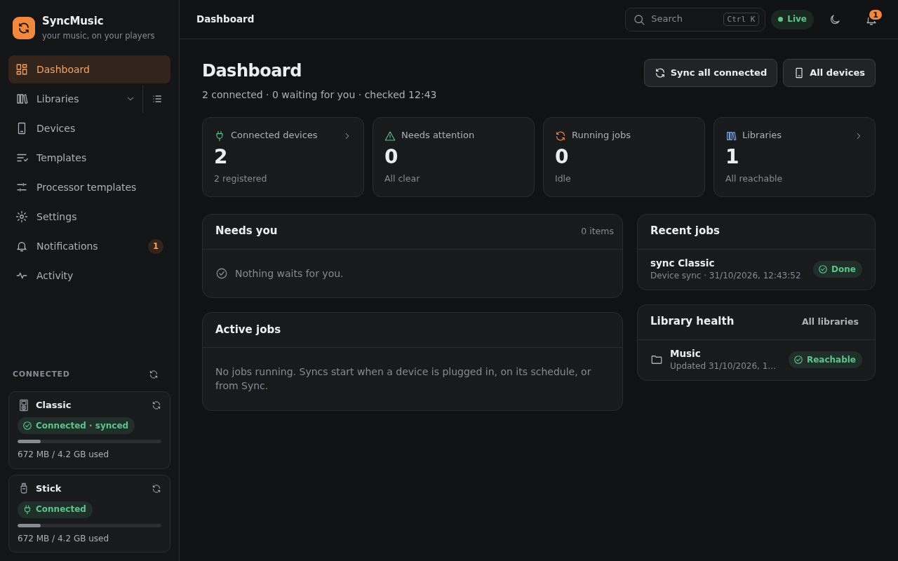

# 1. Overview and concepts

SyncMusic is one program: a background service with a web interface (it also works on a phone), an optional
desktop window and a command line client. You tell it where your media lives and which players you own; it decides
what belongs on each player, prepares the files and copies them over when the player is plugged in.

```
 libraries ──► rules / templates ──► processors ──► device
 (Navidrome,   (what goes onto       (convert,      (iPod, Rockbox, HiBy R1,
  Audiobookshelf, the device)         retag, covers,  USB drive, FTP, SMB)
  folder)                             lyrics)
     ▲                                                   │
     └──────────────── reverse sync ◄────────────────────┘
          (play counts, ratings, favourites, positions)
```



## Libraries
A **library** is where your media comes from. SyncMusic only reads from libraries; it never changes your files.

- **Navidrome** (or another server with the Subsonic API): music, playlists, smart playlists, favourites, ratings.
- **Jellyfin** (beta): movies and episodes, to the player only - nothing is sent back. For music, add another
  library.
- **Audiobookshelf**: audiobooks and podcasts, with listening progress.
- **Folder**: a plain directory of audio files on this machine (or a mounted share).

SyncMusic can look for servers on your local network when you add a library, and has a path browser for
folders.

## Devices
A **device** is a player SyncMusic writes to:

- **iPod** with Apple's firmware (tested on the iPod Classic) - SyncMusic writes the iPod
  database itself, so no iTunes is needed. The iPod nano 6G/7G cannot be supported.
- **Rockbox** players (any player running Rockbox, e.g. an iPod with Rockbox installed).
- **HiBy R1** (SonixOS), and the HiBy R1 with the **Compás** firmware (as USB storage).
- **USB flash drive** or memory card (vfat, exFAT, ext4, NTFS) for car stereos and simple players.
- A folder on an **FTP** or **SMB** server, for players and boxes that share their storage over the network.
- **Android** phones and players over USB (MTP) - **Beta**.

USB devices are recognised when you plug them in. You **register** a device once; from then on SyncMusic knows it
by its serial number or file system and keeps its settings.

## Templates and rules
**Rules** decide what goes onto a device: "all albums rated 4 stars or more", "the last 20 episodes of each podcast",
"unfinished audiobooks", "this playlist". They work like Navidrome smart playlists (you can import `.nsp` files) and
can be built in the web interface or written as JSON/YAML.

Rules are saved as **templates** so several devices can share them. Every library comes with a few ready-made
templates ("All music", "Favourites", "Unfinished books", …). A device gets one or more templates, and optionally
rules of its own. The templates also decide which libraries a device draws from.

## Processors
**Processors** prepare files for a device on the way:

- **Convert** - transcode formats the player cannot play (e.g. FLAC → ALAC, AAC or MP3) or shrink files to save space.
- **Retag** - clean up or rewrite tags (e.g. album artist, compilations).
- **Covers** - embed or resize cover art.
- **Lyrics** - write `.lrc` files next to the tracks.

Each device has its own chain of processors. SyncMusic suggests a chain for each kind of device and warns about
chains that make no sense. Processed files are cached, so the next sync does not convert them again.

## Sync: plan, then apply
A sync always starts with a **plan**: what will be added, updated and removed, and how much space it needs. You
review the plan, then apply it. Two kinds of sync:

- **Update** - small changes (new tracks, changed playlists, new podcast episodes) are written in place. SyncMusic
  can run updates by itself when a library changes and the device is connected.
- **Full sync** - the device content is rebuilt from the current rules.

Every job is kept in the history with its log and a report.

## Reverse sync
What you do on the player matters too. Before every sync SyncMusic reads back:

- **play counts** and **last played** (iPod, Rockbox, HiBy),
- **ratings** and **favourites**,
- **positions** in audiobooks and podcasts,

and sends them to the libraries (Navidrome scrobbles and ratings, Audiobookshelf progress). When the library and
the player disagree on a position, the newer one wins.

**Search and command palette.** Ctrl K (⌘K) or the search button opens one box for everything: music, devices,
templates and jobs, plus pages (*Open Settings*), actions (*Sync …*, *Update … now*, *Eject …*, *Refresh …*, *Sync all*)
and settings (by name or explanation).

**Help in the app.** A small **?** next to a heading (Rules, Processors, the plan, the cache, …) opens a short
explanation with a *Read more* link to this guide. Letters may be skipped (`opn sttngs`); what you used last is listed first.
