# 3. First run walkthrough

Open the web interface (`http://<host>:8765`, or the port you chose). On the very first start SyncMusic opens a
**setup wizard** with six steps: *Library → Device → Templates → Quality → Review → Done*. You can **Skip setup** and
do every step by hand later; this chapter follows the wizard and then explains each part in more detail.

The left menu has **Dashboard**, **Libraries**, **Devices**, **Templates**, **Processor templates**, **Settings**,
**Notifications** and **Activity**. Connected devices also appear as cards in the sidebar, with their free space and a menu (Sync,
Update now, Eject …).

## 1. Add a library
*Libraries → Add* (or the wizard's first step). Choose the type and fill in its connection:

- **Navidrome / Subsonic**: the server address (e.g. `http://navidrome.local:4533`), user name and password.
- **Audiobookshelf**: the server address and an **API token** (Audiobookshelf → Settings → Users → your user → API
  token).
- **Jellyfin** (beta, video only): the server address (e.g. `http://jellyfin.local:8096`), your user name and
  password, or an **API key** (Jellyfin → Dashboard → API keys) instead of the password. Its movies and episodes go
  to players that play video (video-capable iPods, flash drives, network folders), converted by the device's video
  processor where needed; play counts and favourites are not sent back. A device that got music from a Jellyfin
  library in an earlier version keeps it: the plan lists it as gone from its library (orphans) and says
  "Jellyfin now provides video only - attach another library for music".
- **Folder**: a **Local path** (use the path browser), an **SMB share** (`smb://nas.local/music`, user/password or
  **Guest access**) or an **FTP server** (`ftp://host:21/folder`, or **Anonymous login**).

For SMB and FTP, **Find servers on the network** looks for servers nearby and fills in the address (and
**List shares** lists the shares of an SMB server). For a local folder, **Watch for changes** notices added, changed
or removed files about 30 seconds later instead of at the next periodic check (SMB and FTP folders are always checked
periodically). After saving, SyncMusic checks the connection and reads the library; a library that cannot be reached is
saved anyway and marked with its error, so you can fix it later.

Every library brings **default templates** (e.g. "All music", "Favourites", "Unfinished books"; Jellyfin: "All
videos", "All movies", "All series").

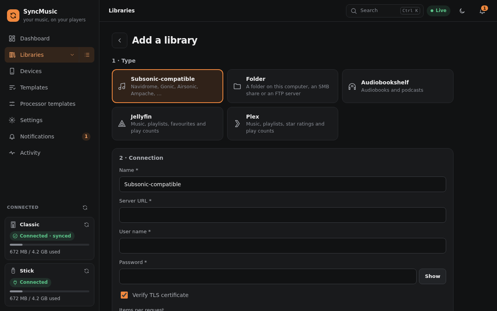

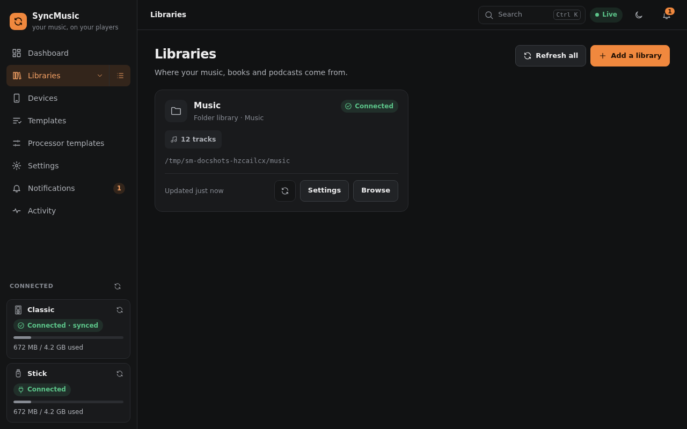

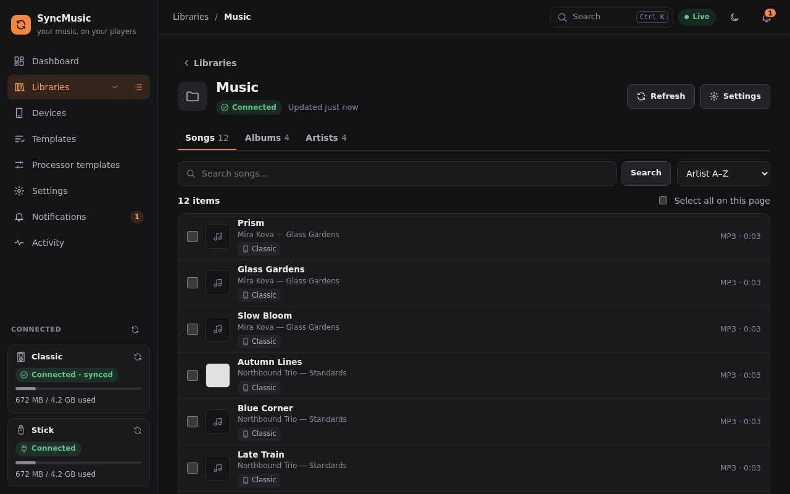

## 2. Register a device
Plug the player into a USB port of the machine SyncMusic runs on. It appears under **Devices** as an unregistered
drive within a few seconds (*Waiting for a device…* in the wizard). Then *Register*. It goes step by step: *Next*
(or Enter) checks the step and opens the next one, *Back* and the step names above go back without losing anything,
and nothing is saved until *Register* on the last step. *Show all steps on one page* shows the whole form at once
(remembered in this browser; *Step by step* switches back).

1. **Device** - SyncMusic detects the type (stock iPod, Rockbox, HiBy R1, USB drive) and shows *Detected: …*; change
   it if it is wrong. An iPod with Rockbox can also be used with its Apple firmware. Give it a **Name**.
   For a server choose **A server (FTP or SMB share)** and enter its address, login and folder.
   **A folder instead (advanced)** writes into a local folder (it cannot be formatted or ejected).
2. **What goes on it** - tick one or more templates (nothing is preselected). *Make a copy for this device* puts
   the chosen templates' rules into a new template you can change on its own; otherwise the device **follows** the
   templates and changes with them.
3. **Processors** - a processor template, a new template with the recommended steps, a **generated chain** made for
   what your templates select (with the estimated size), or only this device's own steps.
4. **First sync** - what happens to the files already on the player:
   - **Adopt what is on the device**: files that match your library are kept and not copied again;
   - **Merge**: keep everything and only add; nothing is removed on the first sync;
   - **Wipe the music folder**: remove all music, playlists and the database first.

   *Format the drive first* (USB drives, iPods) or *Wipe the player first* (Rockbox, HiBy) start from a clean device;
   you confirm by typing the device name. An iPod keeps its partition table and firmware.
5. **Summary** - the name, type, purpose and folder of a USB disk, the templates, the processing and the first-sync
   choice. *Register* creates the device and opens its first plan.

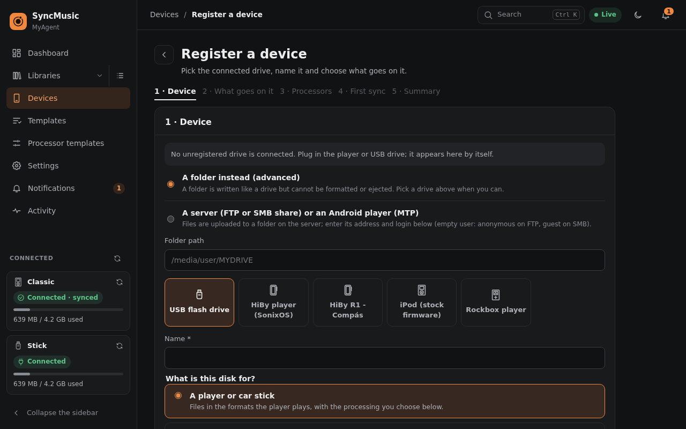

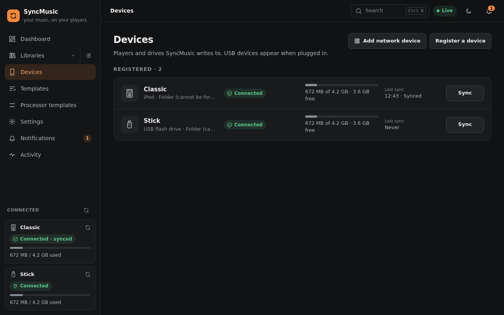

## 3. Templates and rules
*Templates* (menu) or *Device → Templates*. A template contains **Include** rules (what goes on) and **Exclude** rules
(what never goes on). Each rule has:

- **Media** - music, podcasts, audiobooks or any.
- **Match** *all of these* / *any of these* conditions, nestable in **groups**. Each condition is a **Field**
  (artist, album, genre, year, rating, starred, play count, last played, added, playlist, path, …), a **Condition**
  (*is*, *is not*, *contains*, *starts with*, *greater than*, *between*, *in the last* N days, *in playlist*, …) and a **Value**. "Is in / is not in"
  take several values. **Pick from library** lets you choose artists, albums or playlists from a list instead of
  typing.
- **Order and limits** - *Order by* a field (*highest / newest first*), *At most* N items, tracks, hours or a size (e.g. `10GB`);
  podcasts can be limited per show (*episodes of every podcast*).
- **Also create a playlist with these items on the device** - the rule's result becomes a playlist on the player.

A rule without conditions takes everything of its libraries. Templates show a live preview (count and size), and
the **YAML** tab shows the same rules as text; Navidrome smart playlists (`.nsp`) can be imported and used as-is.

Drag a template, a rule or a condition by its grip to change the order (mouse or touch); with
the keyboard focus the grip and press Alt+↑/↓.

Items you send to a device from a library page, or remove from the device's contents, are kept as **hand-picked**
items of the device's own rules.

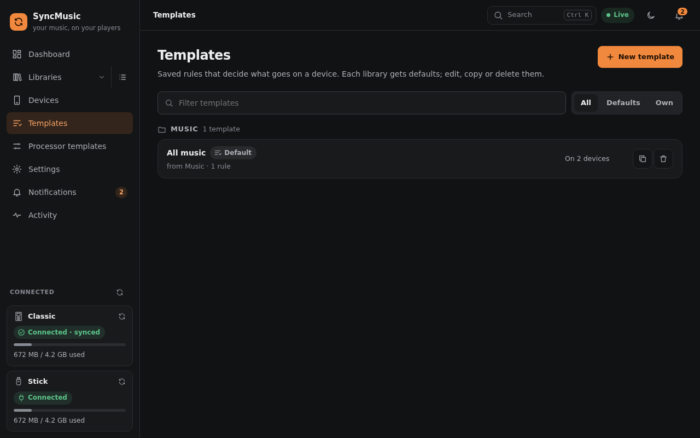

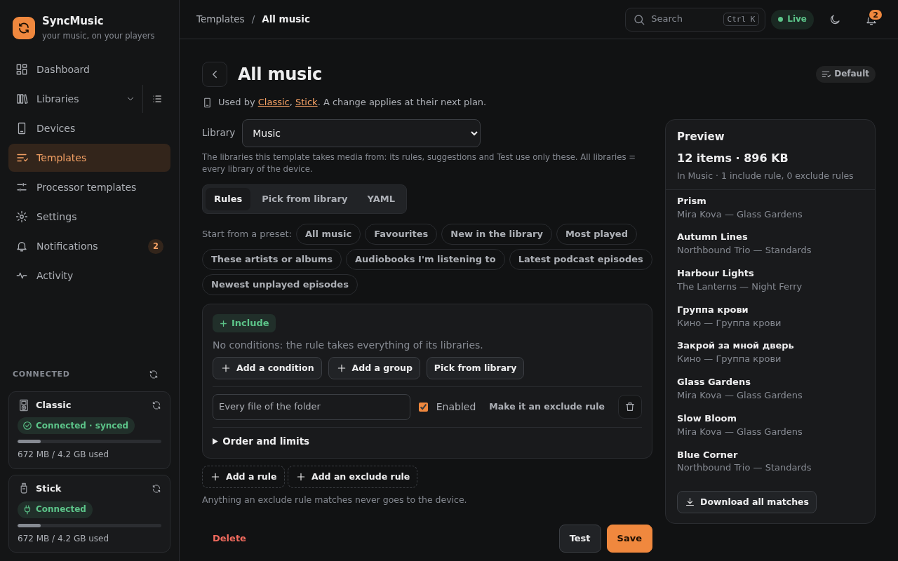

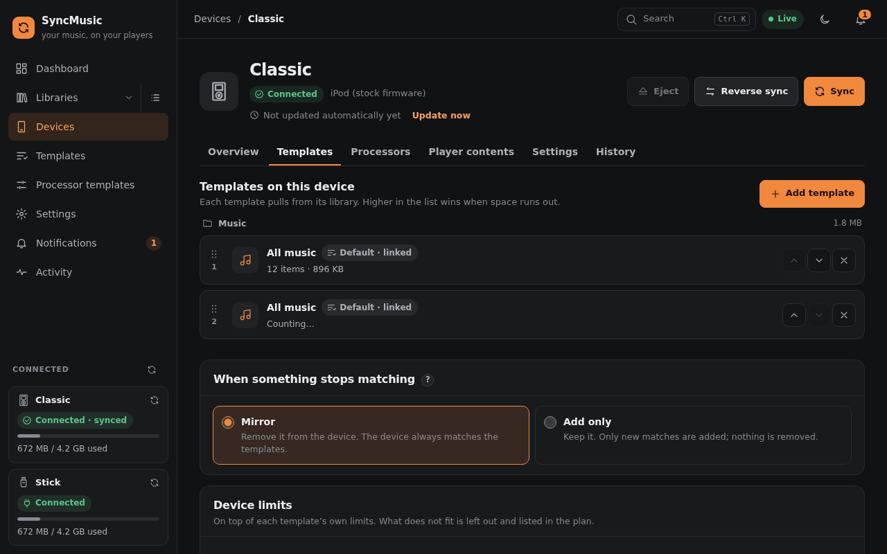

## 4. Processors
*Device → Processors* or *Processor templates*. A chain runs on every file before it is written:

- **Convert** - target format and quality (e.g. ALAC for an iPod, MP3 320 for Rockbox, AAC 256 to save space);
  files the device already plays can be copied as they are.
- **Retag** - tag clean-up (album artist, compilations, sort names), ratings and volume levelling (ReplayGain; iPods
  get Sound Check from it).
- **Covers** - embed and resize cover art, `cover.jpg` next to the files.
- **Lyrics** - `.lrc` files next to the tracks or embedded lyrics.

SyncMusic **suggests** a chain for each device type and warns about chains that make no sense (with a one-click fix).
Steps run top to bottom; drag a step by its grip to reorder it. Converted files are kept in the processing cache, so later syncs and other devices do not convert them again.

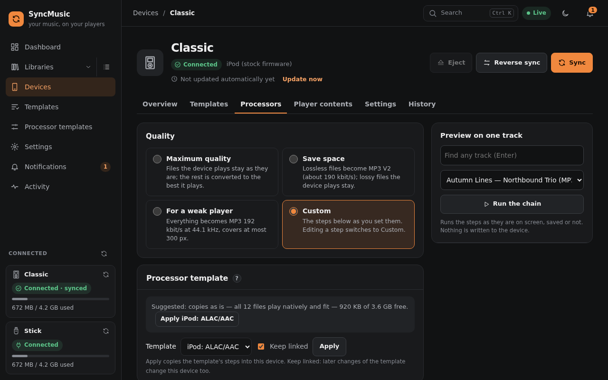

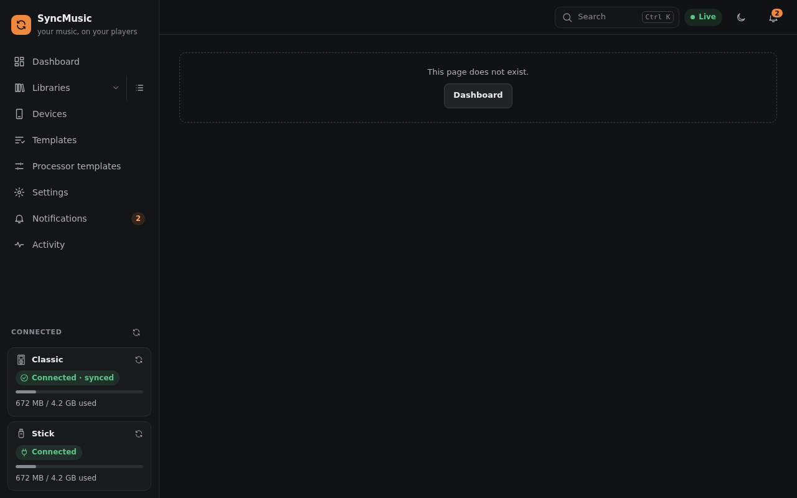

## 5. Review the plan
*Device → Sync* builds a **plan** - *nothing is written until you apply*. It shows:

- what will be **added**, **replaced**, **removed** and **written** (playlists, database), grouped by template, with
  totals and a sample of items;
- the **space** after the sync (*used of total · free · fits / does not fit*); if it does not fit, choose what to
  leave off or pick fewer templates;
- warnings (a slow or fragile device can be switched to **gentle write mode** right from the plan);
- a **confirmation box** when the plan removes or re-processes more than the device's delete threshold - e.g.
  "SyncMusic changed how the files are processed" after a settings edit or an update; *Apply* needs the tick. It
  says what changed, old → new (e.g. `device: formats -wav`, `transcode: bitrate 256 → 320`), and so does each
  re-processed item's reason; for files synced before this was recorded: "previous values unknown".

**Apply · write N GB** starts the sync. A plan becomes outdated when the device or its settings change; then plan
again.

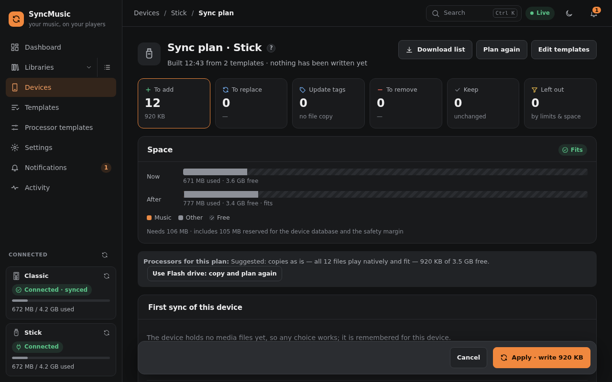

## 6. Sync, progress and history
The sync runs in the background: you can close the page, the sidebar shows the progress. Before writing, SyncMusic
does a **reverse sync** (play counts, ratings, favourites and positions go back to the libraries). When it ends, the
device can be **ejected** (*Eject*: unmounted and powered off - unplug it when it says so).

When ten or more and over half of a player's favourites (or ratings) vanish at once, SyncMusic takes it for a reset
player database: it keeps them in the library, warns in the sync report and puts them back on the player. If you
removed the favourites on purpose, *Remove them from the library* in that report entry (*History*) sends the
removals with the next sync.

A sync that changed favourites or ratings in a library can be taken back: *Undo these changes* in its *History*
entry sends the previous values to the library with the next sync, and the player follows.

While a device stays connected, SyncMusic runs **updates** by itself: on plug-in, when a library changes (at most
every 15 minutes by default) and on a schedule (*Settings → Sync*); *Update now* runs one at once.

*Device → History* lists every full sync and update with its result (*succeeded*, *partial*, *failed*),
what was sent back to the libraries (the *Sent back* filter shows only those reports, and in them only what went to the libraries), the errors and a link to the **full report**.

The device's **Overview** shows its capacity; open **What takes the space** for the used space by library and by
rule (plus the device database, files SyncMusic did not write and the safety margin). **Player contents** lists
what is on the player as a list or a cover **grid** (the toggle above the list), sortable by album, year, date added
or size; Shift-click selects a range.

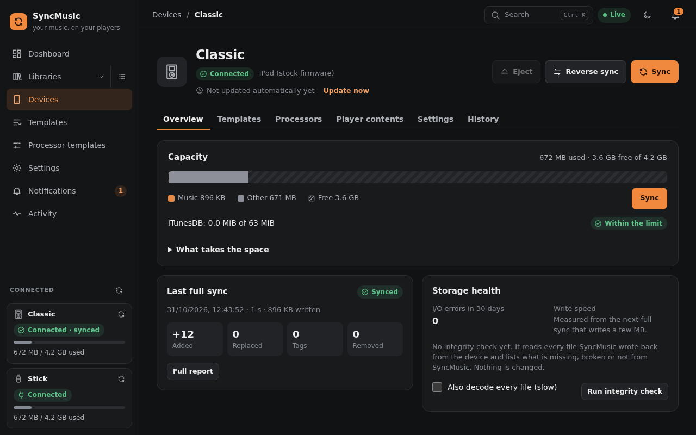

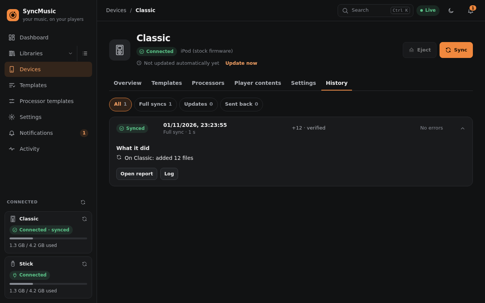

**Activity** (menu) lists what SyncMusic did on all devices and libraries, newest first: files added, replaced and
removed, playlists written, and the plays, ratings, hearts and positions sent back. Each entry says where it went
(*… to My R1*, *… to Navidrome*); a smart playlist that only came back in another order is rewritten but not listed.
Filter by device and kind; each entry links to its report.

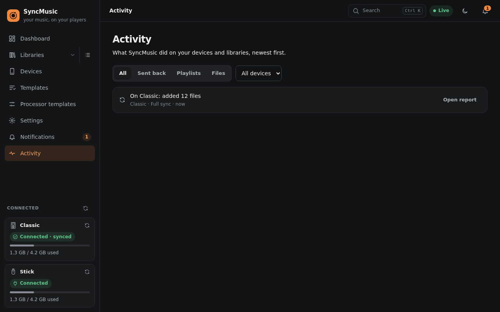

**Dashboard.** The *Needs you* list collects everything that waits for you: failed syncs, items that did not fit,
listening data a library has not taken yet, system check warnings. Each entry links to where you fix it or can be
dismissed. Next to it are the active jobs with their live progress (step, MB written, speed) and the library health.

On a phone the same pages stack into one column:

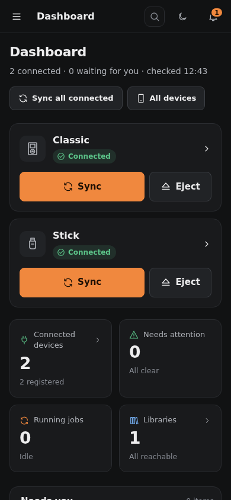 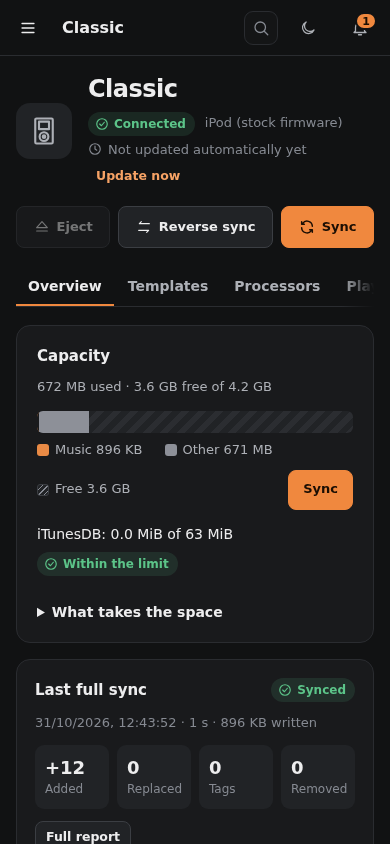 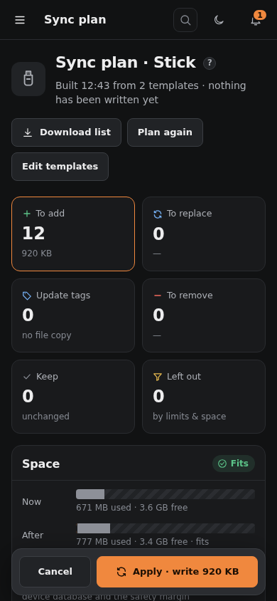

**Getting started card.** Until a library, a registered device with templates and a first successful sync exist, the
Dashboard shows a *Getting started* checklist; each step links to its page. Close it with × (remembered in this
browser).
