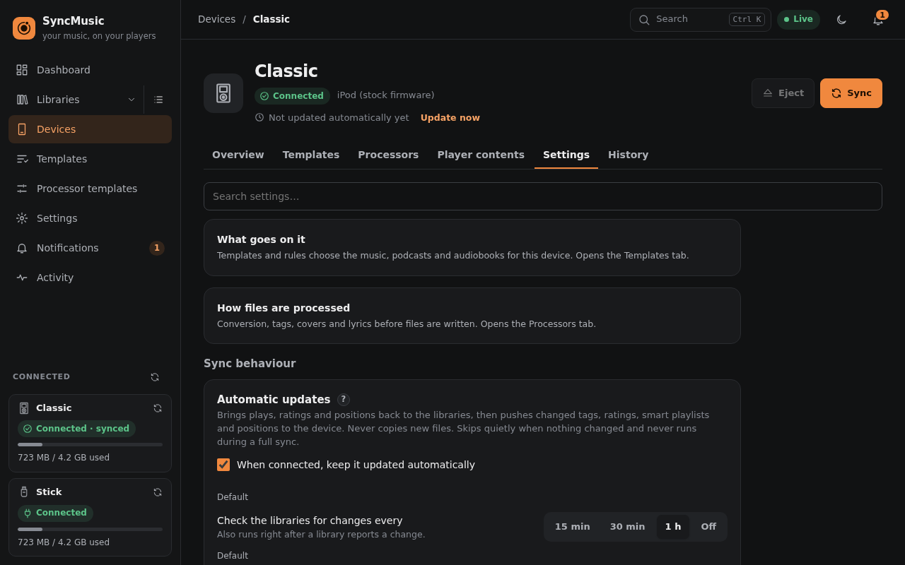

# 4. Device guides

What SyncMusic does differently for each kind of player. Every device can be renamed, its templates and processors
changed and its history viewed at any time; **Format** and **Wipe** always ask you to type the device name first.

With two or more players connected, **Sync all connected** (dashboard, or the sync icon next to *Connected* in the
sidebar) starts a full sync or an update on each of them. Devices that are busy, ejected or have no templates are
skipped and named; a device whose plan needs a review waits for you on its own page.

## iPod (Apple firmware)
- **Models:** iPods with a hard disk or flash that use Apple's iTunes database (tested on the iPod Classic).
  The **iPod nano 6G and 7G are refused**: their database needs a checksum that cannot be written.
- **No iTunes needed.** SyncMusic writes the iPod database, artwork and playlists itself and saves them crash-safely.
- **Formats:** MP3, AAC, ALAC, WAV, AIFF - no FLAC, Opus or Vorbis. The suggested processor chain converts FLAC to
  ALAC (lossless) or AAC; 24-bit or high sample-rate files are converted down to what the iPod plays.
- **Artwork** in the sizes of your model; **Sound Check** from the library's ReplayGain tags.
- **Podcasts and audiobooks** appear in the iPod's Podcasts and Audiobooks menus; an audiobook made of many files can
  be combined into one track with chapters.
- **Reverse sync:** play counts, ratings (stars) and bookmarks (positions) go back to the libraries.
- **Clock:** the iPod's clock is set on every sync.
- **Format** erases only the **data partition**; the partition table and the firmware partition are never touched.
- An iPod running **Rockbox** can be registered as Rockbox or (if it still starts Apple's firmware, hold *Menu* while
  booting) as a stock iPod.

## Rockbox
- **Any Rockbox player** (iPods with Rockbox, AIGO EROS Q, …) - recognised by the `/.rockbox` folder.
- **Music only**: podcasts and audiobooks are not synced to Rockbox players.
- **Formats:** almost everything (MP3, FLAC, Ogg, Opus, AAC, ALAC, WavPack, …); the suggested chain copies files as
  they are, or "Rockbox: MP3 320" to save space.
- Playlists are written as `.m3u8` files; Rockbox rebuilds its database after the sync (*Settings → General →
  Database → Initialize now* on the player if it does not).
- **Reverse sync:** play counts from Rockbox's playback log (*Settings → Playback → Logging* must be on).
- **Wipe** removes all music, playlists, Rockbox's database and play logs; Rockbox itself and its settings stay.

## HiBy R1 (SonixOS)
- **Reboot the player after every sync** (or after unplugging) so it reads the new music, playlists and
  favourites. SyncMusic reminds you of it.
- Music goes to `Music/`, podcasts to `Podcast/<show>/`, audiobooks to `Audiobooks/`, with `.lrc` lyrics and cover
  art. All formats the R1 plays are copied as they are.
- **Playlists** are written into the player's library database (the R1 ignores `.m3u8` files). Playlists you made on
  the player stay, and are sent back to Navidrome by the reverse sync. A player-made playlist that exists in the
  library but is in none of your rules is removed from the player.
- **Favourites (hearts) ↔ Navidrome stars**, in both directions. The R1 has no star ratings.
- **Reverse sync:** play counts, favourites, audiobook and podcast positions.
- A **full sync** rebuilds the player's databases from your libraries (after the reverse sync), so the player's
  history and "now playing" state start empty. Updates change only what changed.
- **Wipe** erases music, playlists, podcasts and audiobooks and the player's library, play counts, favourites and
  resume positions; its settings stay. **Format** creates a new exFAT (or FAT32 / NTFS) file system on the whole
  player. The firmware is never touched.
- Before each change to the player's databases SyncMusic keeps a copy under `<cache>/device-backups/`.
- The player's databases are built on the computer and copied onto the player only when their content changed, by
  writing a new file and renaming it over the old one, so an unplug never leaves a half-written database behind. An
  update with nothing new writes nothing to the player.
- **Eject before unplugging**, and after unplugging let the R1 finish updating its library before you connect it
  again or switch it off. If the player's file system is reported as damaged, use **Repair** on the device page (or
  check the card on a computer: `fsck.exfat` / `fsck.vfat`). SyncMusic checks this as soon as the player is
  connected (the card mounted read-only, or its databases unreadable) and starts no automatic sync until it is repaired.

### Tips for the HiBy R1
The device page shows these as *Tips for this player* (Overview tab; close the card to keep it collapsed).
- **Eject** in SyncMusic before unplugging. After unplugging, let the R1 finish updating its library before you
  connect it again or switch it off - this protects its library database.
- If new music does not show after a sync, **reboot the player** (the *Last full sync* card shows this hint after
  every sync, so the tips card does not repeat it).
- **Detect changes** (on the R1: *Settings → Library*) can be off when only SyncMusic fills the player: it starts
  faster and does not rewrite its database. Keep it on if you also copy files by hand. SyncMusic cannot change it.
- **Split genres**, **Split artists** and **Join albums** are settings of the player (*Settings → Library*).
  *Device settings → Player library → Split genres* follows the player by default and can be set to **Off** or **On** (with the
  separators: `;` `/` `&` `,` `+` and a live example), but the R1 files its genres again its own way after
  unplugging: choose the same on the player (*Settings → Library*). The sync report warns while the two differ.
- **exFAT** is the recommended file system for big cards. If the player or the computer reports file system errors,
  run **Repair** on the device page.
- Do not let the computer's own automounter (or a file manager window) open the player while SyncMusic uses it.

## USB flash drive or memory card
- For car stereos, simple players and anything that reads a folder of files. **One way only**: nothing is read back.
- **File systems:** exFAT or FAT32 recommended (FAT32 has a 4 GB file limit); ext4 and NTFS work too. NTFS that was
  unplugged without *Eject* may refuse to mount ("volume is dirty"): repair it in Windows (`chkdsk /f`) or format it.
- **Device settings:** the formats the target player plays, the **folder layout** (e.g. `Artist/Album/01 Title`),
  ASCII-only names for old players, lyrics as `.lrc` or embedded, `.m3u8` playlists on or off.
- **Format** may create a new partition table and one partition (vfat, exFAT, ext4 or NTFS).
- **Car stereo / old player mode** (*Device settings → Files on the device*): file and folder names in plain ASCII
  (Cyrillic and accents transliterated, emoji and other characters replaced) and short paths - at most 128
  characters per path and 64 per name by default, both adjustable - and at most 255 files in one folder (the next
  ones go to *Album (2)*, *Album (3)* …). After switching it, the next sync renames the files already on the drive.

## Android phone or player (MTP) - Beta
- Plug it in, unlock it and choose **File transfer** in its USB menu: it appears among the found devices (dashboard,
  *Register a device*) with its model, its USB serial and a **Beta** badge; register it from there like a drive. A
  registered player is recognised whenever it is plugged in (on-connect sync, sync windows, eject after a sync).
- On *Register a device* the USB serial is shown read-only (it is the player's identity). Choose the **Storage**
  (read from the player, with size and free space; an SD card is preselected) and the **Folder on the device**:
  `./` (the storage's top folder, the default) or one picked with the folder button next to the field.
  Playlists go as `.m3u8` into its *Playlists* folder. **Wipe** deletes only the files SyncMusic put there; the
  player is never formatted.
- **Settings → Files on the device** has the same **path layout** as a USB drive (music, multi-disc music, podcasts,
  audiobooks, video, each with a live example), the **Folder on the player**, the playable formats and playlists on
  or off. After a layout change the next sync re-writes the files at their new paths and deletes the old ones.
- **Eject** ends SyncMusic's use of it; unplug it afterwards. There is no storage health or integrity check.
- Known limitations: no play counts, ratings or positions come back (they live in each player app); the phone's
  media scanner may take a while to show new files; a file manager (gvfs, KDE) that holds the phone makes it
  **busy** - close it or re-plug; a locked phone shows **no storage** - unlock it. Needs `libmtp` on the host.
- Tested on a GammaOS Next handheld (sync, playlists, second sync, eject, Wipe). Whether a player app picks the
  files up depends on the phone's media scanner and has not been checked yet - tell us how it goes on yours.
- Without detection (e.g. in a container) add it by hand under *A server … or an Android player (MTP)* with its USB
  serial.

## FTP server or SMB share
- For players, streamers or NAS folders reachable over the network. Register with *A server (FTP or SMB share)*:
  address, user (empty = anonymous on FTP, guest on SMB), password and the **folder** to write into.
- The folder gets the same layout as a USB drive; SyncMusic keeps its bookkeeping in a hidden `.syncmusic/` folder
  there. The FTP server must allow renaming and files whose names start with a dot.
- **Space:** SMB reports free space; FTP cannot, so set a **quota** (GB) in the device settings if the plan should
  check it.
- Network devices are never formatted or ejected.
- **Automatic syncs:** a server is never "plugged in", so it gets an **update every 6 hours** by default and, if you
  set one, a daily full sync (*Sync settings*). Before each automatic start SyncMusic logs in; when the server does
  not answer, the sync is skipped quietly, the device says **Not reachable since …**, and the next slot tries again.
  *Sync all* skips it too ("not reachable").

## A player used by more than one SyncMusic
A player remembers which SyncMusic installation set it up: its **home**. When you register a player that another
installation (or an earlier registration) synced, the *First sync* step asks how to go on:

- **Continue** (the default) keeps everything on the player, including the other installation's items, and adds
  your libraries. Automatic sync on connect stays off here: it belongs to the home.
- **Start fresh** wipes the music on the first sync. Only the home can do this.
- **Keep files** registers the player as a new device; what is on it counts as files SyncMusic did not put there.

On a player whose home is another installation, **Wipe**, **Format**, removing files SyncMusic did not put there and
writing player settings are left to the home: the *Danger zone* says which installation that is.
**Make this instance home…** moves the home here (the other installation keeps syncing its own libraries).

Every full sync also stores the templates the device uses on the player (`.syncmusic/templates.json`; rules only,
no processors or device settings). On another installation the device's **Templates** tab then lists them under
**From other installations**: **Import** makes a copy of your own, linked to this device, with its libraries matched
to yours (the same server, or a library you paired). A template that draws only from libraries you do not have is
listed but cannot be imported. Your copy is never changed behind your back: when the original changes, the row says
*Updated on <installation>* and **Update my copy** takes the new version.

Only one installation writes to a player at a time: a sync, update or wipe marks the player as busy
(`.syncmusic/lease.json`, refreshed every minute). Another installation that wants to sync it meanwhile stops with
"being synced by <installation> since <time>"; a mark that has not been refreshed for ten minutes (that installation
stopped, or the player was unplugged mid-sync) is taken over.

## Gentle write mode
Some players (old iPods with tired disks, cheap cards) fail under long writes. *Settings tab → Gentle write mode*
writes in small batches with pauses and a rate limit. The plan suggests it when a device had write errors.
