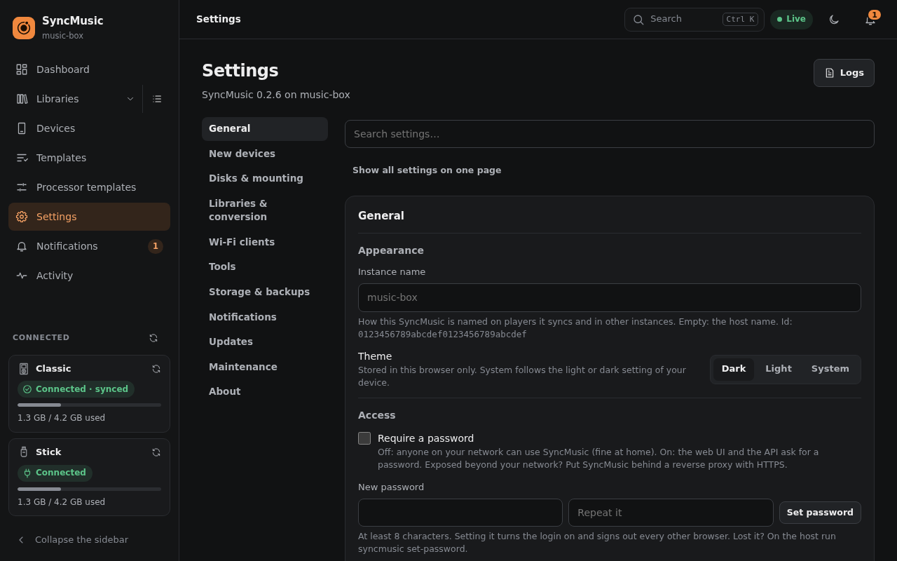
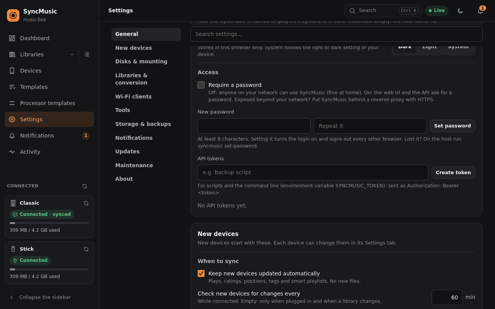
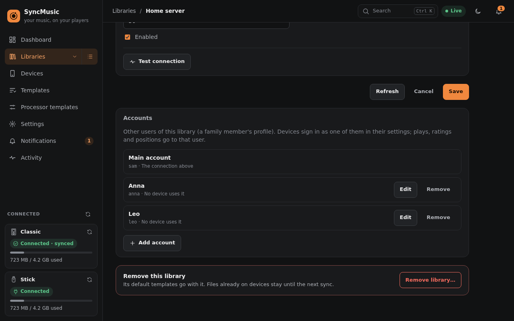

# 5. Settings reference

SyncMusic has three kinds of settings:

1. **Start-up settings** (config file, environment, command line) - where it keeps its data and how it listens;
   see [Installation → Paths and options](02-installation.md#paths-and-options). `syncmusic config init` prints
   them all with their defaults.
2. **Application settings** - *Settings* in the web interface (stored in the database).
3. **Device settings** - per device, on the device's *Settings* tab (groups *General*, *When to sync*, *After a sync and mounting*, *Safety*, *Listening data*, *Writing*; the rest folded under *Advanced*).

The key names below are the ones the API uses (`GET/PATCH /api/v1/settings`, `/api/v1/devices/{id}`) and the ones
an export file contains.

See also the generated [Settings reference](08-settings-reference.md).

## Application settings (*Settings*)

Settings shows one section at a time: pick it in the menu on the left (a list at the top on a phone). Each section has its own address (`#/settings/updates`, `#/settings/maint`, …) to link to. **Show all settings on one page** puts every section on one page again; the choice is remembered in this browser and also applies to a device's *Settings* tab. The search box always searches every section; Enter opens the section of the first hit.

### Sync (and Appearance under System)
What a **newly registered** device starts with; each device can change them later.

| Key | Default | Meaning |
|---|---|---|
| `default_on_connect` | `manual` | When a device is plugged in: `auto` sync, `ask` (notification), `manual` (only when you press Sync). Updates run regardless. |
| `default_update_sync` | on | Run updates while the device is connected. |
| `default_update_every_min` | 60 | Check for changes every N minutes while connected (empty: only on connect and when a library changes). |
| `default_verify` | `all` | Read back after a full sync: every file, a 10 % `sample`, or `off`. |
| `default_eject_after` | `off` | Eject after a successful sync: `off`, after a `full` sync, after `any` sync. |
| `automount_wait_s` | `5` | Seconds to wait after a disk is plugged in before SyncMusic mounts it, so a host automounter (Umbrel, a desktop) can mount it first and SyncMusic uses that mount instead of a second one. |
| `default_stay_ready` | `true` | New disk devices stay ready between syncs (see `stay_ready`); devices registered before keep their setting. |
| `default_no_cache` | off | Do not keep converted files in the processing cache (saves disk, converts again next time). |
| `default_no_cache_files` | 4 | No-cache mode: files waiting in memory for the device write. |
| `default_no_cache_budget_mb` | 1000 | No-cache mode: memory for those files together (MB). |
| `default_no_cache_file_max_mb` | 256 | No-cache mode: bigger files are spooled to disk instead (MB). |
| `write_limit_mb_s` | none | Write speed limit for every USB device's full sync (MB/s). |
| `db_backup_every` | daily | Automatic database backups: off, 6h, daily or weekly. One is also made before an update and before a factory reset. |
| `db_backup_keep` | 7 | How many database backups are kept. |
| `db_backup_dir` | `<data_dir>/backups` | Where the backups go (gzip; secrets stay in them as in the database). |
| `update_change_gap_min` | 15 | A library change starts a device update at most this often (minutes). |
| `max_device_syncs` | no limit | Device syncs running at the same time. |
| `concurrency` | CPUs − 1 | Conversion threads (takes effect after a restart). |
| `compas_sdtool_path` | none | *HiBy R1 with Compás*: the compas-sdtool program (empty: next to SyncMusic, then `<data_dir>/tools/`). **Check tool** shows its version and library format; **Download** fetches it from SyncMusic's release after you confirm (checksum, architecture and version are checked). With SyncMusic's update check (daily and at start) the copy SyncMusic downloaded is kept at the build SyncMusic's release offers: the newer one is checked like a download and swapped in while no sync runs (the previous one stays as `….previous`); a tool you set here or put next to SyncMusic yourself is never replaced, the line under it only says what the release offers. compas-sdtool is part of [Compás Tools](https://github.com/Starnished66/compas-tools) (GPL-3.0); see [THIRD-PARTY.md](../THIRD-PARTY.md). |
| `clients_allowed` | off | *Wi-Fi clients*: client apps may pair with this server and sync over the network. Off: the client API refuses every request and nothing is announced. Plain HTTP: use it only on a network you trust. |
| `clients_mdns` | on | Announce the server on the local network (mDNS) while Wi-Fi clients are allowed, so apps find it without typing an address. |
| `client_code_minutes` | 1 | How long a pairing code (8 digits) stays valid (single use; at most three are open at once). |
| `client_pair_requests` | on | A client may ask to connect without a code; you approve or reject it on the Devices page (it shows the same short code as the player). |
| `client_poll_s` | 300 | How often a paired client asks whether a sync is due (seconds). |

### Libraries
| Key | Default | Meaning |
|---|---|---|
| `snapshot_refresh` | `sync` | When SyncMusic re-reads a library: before every `sync`, at most `hourly`, or only on `manual` *Refresh*. |

### Storage (Cache & space, Backup)
| Key | Default | Meaning |
|---|---|---|
| `cache_max_gb` | 20 | Size of the processing cache; the least recently used files are removed above it. |
| `cache_combined_books` | on | Keep combined audiobooks in the cache even for no-cache devices (they take long to build). |
| `history_days` | 90 | Sync history and reports older than this are deleted (the newest of each device is kept). |
| `log_days` | 14 | Rotated log files older than this are deleted. |
| `disk_warn_gb` | 5 | Warn when the disk with SyncMusic's data and cache has less free space (GB; empty: no warning). |

### Conversion
| Key | Default | Meaning |
|---|---|---|
| `ffmpeg_path` | from `PATH` | The ffmpeg program (ffprobe is expected next to it). |
| `convert_nice` | 10 | CPU priority of conversions (0 = normal, 19 = lowest). |

### Notifications
| Key | Default | Meaning |
|---|---|---|
| `inbox_events` | all | Which events the notification centre (bell) keeps. |
| `notification_days` | 7 | Notifications older than this are deleted (empty: kept). |
| `webhook_url` | none | Send events as JSON `POST` to this URL (e.g. ntfy, Home Assistant, Gotify). |
| `webhook_events` | connected, unknown device, sync started / needs confirmation / finished / failed, database size warning | Which events go to the webhook. |
| `quiet_hours` | none | No webhook between two times (`start`/`end`, `HH:MM`, may cross midnight). |
| `default_sync_windows` | none (any time) | Sync windows a new device starts with (see *Sync windows* below). |

### System (Maintenance, Updates, Import / export)
| Key | Default | Meaning |
|---|---|---|
| `log_level` | from the config file | `DEBUG`, `INFO` or `WARNING`, changed without a restart. |
| `auto_update` | off | Installing a new version (the single-file program and its service only): `off` - only tell you; `after_syncs` - once no sync runs (automatic syncs wait meanwhile); `now` - at once, running syncs stop and continue after the restart. Automatic updates come from the daily check only: *Check now* never installs anything, it shows the new version and an *Update now* button. While a version installs, Settings → Updates shows the download (percent, size, speed), the check and the install; during the restart every open page shows *Restarting SyncMusic…* and reloads itself when the new version answers, then says which version runs. A new version that does not start is replaced by the previous one again (the page says so after the reload). |
| `update_channel` | `stable` | Which GitHub releases count as updates: `stable` releases only, or `beta` - also the test builds made from every change. SyncMusic checks once a day and on *Check now*; it shows the new version, what changed and the download for your kind of install (Docker: pull the new image). The configuration file's `update_repo` (default `Bionded/SyncMusic`, `none` = no checks) names the repository - or the full `https://` address of a releases list in GitHub's format, for a mirror. |

**Storage & resources** (under System) lists everything SyncMusic keeps on disk - the database, database
backups, logs, library snapshots, the media and system cache, copies of players' databases, the tags read for
*Player contents*, local copies of FTP/SMB folder libraries, Wi-Fi player data, temporary files and the unpacked program - each with its
size, its folder (copy button) and one action to clear it; copies of players' databases and server folders can be
deleted per device or library. *Wi-Fi player data* is listed per player: *Clean* removes the files still waiting
for it (prepared again at its next sync) and everything of a player that no longer exists, and keeps the copies its
player database is built from (only each song's tags and stream headers, not the whole file). Data of deleted or merged Wi-Fi players is also removed by itself. *Unpacked program* keeps the running version and the one an update can go back to; *Remove old versions* deletes the rest, which SyncMusic also does by itself at start, every hour and after an update, wherever it is installed. Clearing asks first and says how much it frees; parts a running sync may use can only be
cleared when no job runs. The database, the configuration and anything on a device are never offered for deletion.
Below it: memory used, helper processes, CPU now and on average, uptime, threads, response delay and the in-memory caches,
refreshed every few seconds, with *Free memory now* to drop what is rebuilt on demand (a pending plan that only keeps what is already on the device is dropped too; one with changes stays). The same is available as
`GET /api/v1/system/storage` and `GET /api/v1/system/resources`.

**Backup** downloads libraries, devices, templates and settings as one file (history, listening data and the cache
are not in it); passwords and the webhook URL only when you tick *Include passwords* - then keep the file safe.
**Import / export** moves single device settings and templates between installations; passwords are never exported.
**Access** (optional login): *Require a password* (off by default) - when on, the web interface and the API ask for
it. *Set password* (at least 8 characters) turns it on and signs out every other browser; *Sign out everywhere* ends
every session (this one too). **API tokens** for scripts and the command line (environment variable
`SYNCMUSIC_TOKEN`): give a name, copy the token at once - it is not shown again - and *Revoke* it when no longer
needed. The login is not part of a backup and a restore keeps it.

**Appearance → Instance name** (`instance_name`, default empty): what this SyncMusic installation is called (empty: the host name). It is shown
under the logo and in *About*, next to the installation's id, which is made at the first start and stays the same
across updates; a fresh install gets a new one.

**Appearance → Theme**: Dark (default), Light or System (follows your device's light/dark setting). Stored in this
browser only; the sun/moon/monitor button in the top bar switches between the three as well.

## Device settings

A device's *Settings* tab opens on **Basic**: the device's name, automatic updates, full sync when connected, the
schedule, what happens after a sync and gentle write mode, plus links to its templates and processors. The menu on
the left (a row at the top on a phone) holds the **advanced** sections — Files and paths, Listening data, Safety and
writing, This player, Maintenance — and the **Danger zone** last. A section only appears when it applies to the
device (no listening data for a player that records none, no mount options for a folder or a network device). The
search above the menu covers every section. With **Show all settings on one page** (Settings) every section is on
one page and the menu jumps to it.

Every change is saved at once (a text field when you leave it): a short *Saved* note with **Undo** confirms it.
Input that is not valid is marked and not saved. A setting changed from the app-wide default shows *Changed* with a
reset button.

**Files and paths → Folders and file names** offers ready-made layouts (Album artist / Year – Album / Track,
Artist / Album / Track, Album artist – Album / Track, All in one folder) with an example path; **Custom…** shows the
templates for every media kind.

### Settings tab - sync settings
| Key | Default | Meaning |
|---|---|---|
| `on_connect` | from Settings → New devices | `auto`, `ask` or `manual` when the device is plugged in. |
| `sync_at` | none | A daily sync at this time (`HH:MM`) while the device is connected. |
| `sync_windows` | none (any time) | Automatic syncs (on connect, update syncs, the daily sync) start only inside these windows: `start`/`end` `HH:MM` (may cross midnight), `days` 0 = Monday. Outside, a change waits for the next window; Sync now always works. |
| `update_sync` | on | Updates while connected. |
| `update_every_min` | from Settings → New devices | How often updates check for changes. |
| `update_removals` | off | Updates may also remove what no rule selects any more (otherwise removals wait for a full sync). |
| `update_remove_played` | on | …but items played, finished or rated on the device are removed by updates too. |
| `remove_deleted` | on | Items deleted from their library are removed from the device. |
| `delete_threshold_pct` | 20 | A sync that would remove more than this share of the device asks first. |
| `rating_priority` | `device` | When device and library ratings differ, which one wins. |
| `verify` | `all` | Read back after a full sync: `all`, `sample` or `off`. |
| `eject_after` | `off` | Eject after a successful `full` or `any` sync. |
| `use_existing_mount` | `true` | A player another program already mounted is used through that mount, never mounted a second time. Off: such a player is refused until the other mount is gone. An eject after a sync leaves another program's mount alone unless `unmount_foreign` is on; eject it from the device page instead. |
| `stay_ready` | `false` | Stay ready between syncs: the device stays connected but is unmounted whenever no sync or view has used it for about 20 seconds, so it can be unplugged or switched off at any time without damage. Syncs on request, on a schedule or on library changes mount it again by themselves. The device page and sidebar show *Ready - safe to unplug*. An eject after the sync still wins. Disk devices only. |
| `combine_audiobooks` | on for iPods | A multi-file audiobook becomes one `.m4b` with chapters. |
| `playlist_conflicts` | `ask` | A playlist changed on both sides, or a player playlist named like a library one: `ask`, `merge`, `replace` (device wins), `ignore` (library wins), `rename`. |
| `backup_device_db` | off | Keep a copy of the device's database before each sync. |
| `backup_keep` | 5 | How many of those copies to keep. |
| `safety_margin_pct` | 1 | Space left free on the device (percent of its size)… |
| `safety_margin_min_bytes` | 100 MB | …at least this much… |
| `safety_margin_max_bytes` | 500 MB | …and at most this much (the minimum wins if larger). |
| `no_cache` | from Settings → New devices | No-cache mode for this device (see above). |
| `no_cache_files`, `no_cache_budget_mb`, `no_cache_file_max_mb` | 4, 1000, 256 | Its memory limits. |
| `gentle_write` | off | Gentle write mode: write in batches with pauses. |
| `keep_disk_awake`, `keep_disk_awake_s` | off, 2 | Gentle-mode option: while the sync waits, read a few uncached bytes from the disk every `keep_disk_awake_s` seconds so it never falls into standby (CF/SD adapters that never wake up). Only reads. |
| `unmount_foreign` | off | Unmount other programs' mounts of the player (a system automount) during the first minute after SyncMusic mounted it. |
| `foreign_read_only` | off | Make other programs' mounts of the player read-only during the first minute after SyncMusic mounted it: they can still read it, only SyncMusic writes. `unmount_foreign` wins when both are on. |
| `gentle_batch_files` | 25 | Files per batch. |
| `gentle_pause_s` | 2 | Pause after each batch (seconds). |
| `gentle_rate_mb_s` | none | Write speed limit in gentle mode (MB/s). |

### Reverse sync
| Key | Default | Meaning |
|---|---|---|
| `enabled` | on | **Bring back listening data from this player**: read listening data back before every sync. Off: nothing goes back, whatever the switches below say. |
| `plays` | on | Play counts and last played (a play adds one to the count and sets the time; the two always go together). |
| `favourites` | on | Hearts added or removed on the player go to the library's favourites. |
| `ratings` | on | Star ratings set on the player go to the library rating. A heart never becomes stars or the other way round. |
| `positions` | on | Audiobook and podcast positions. |
| `finished` | on | Episodes and books played to the end are marked as played (needs `positions`). |
| `playlists` | on | Playlists changed or made on the player go back to the library. |

The switches are in the device's **Settings → Basic**, indented under the master switch. Settings saved by
older versions keep their meaning: their one ratings switch now sets both `ratings` and `favourites`.
A Compás player counts a play as soon as a track starts, also when you skip it; turn off `plays` for it if
that matters to you.

The page shows only the switches for what the player records: a USB stick has no reverse sync at all, a
Rockbox player no positions, an iPod or Rockbox player stars but no hearts, the HiBy R1 with SonixOS hearts but
no stars, a Compás player stars (1.6.0 and newer) or hearts (older), a Wi-Fi client what its app sends.

### Library accounts
A family member's player can use **their own** profile on a shared Navidrome, Jellyfin or Audiobookshelf.
First add the user to the library: *Libraries → (library) → Edit → Accounts → **Add account***, with a display name
and their user name and password (Navidrome, Jellyfin), or API token (Audiobookshelf); **Test** signs
in without saving. Then pick the account in the device's *Library accounts* dropdown (or choose **+ Add account…**
there to add one without leaving the page). The device then plans from that user's ratings, stars, play counts and
positions, and everything the reverse sync sends back lands on that user; devices of the same user share one
library index. (Jellyfin sends nothing back: its account only picks whose library is read.) The library itself and other devices keep the main account; the plan shows "Signed in as: …".
An account a device uses cannot be removed - the library page says which devices use it. Folder libraries have
no users, so they are not listed. Stored secrets show as `********`; leaving the mask keeps them.

To see what another user has, choose them under **View as** in the library browser, in the template editor's
preview and in *Pick from library* (the device's *Library accounts* card links to the browser as its account).
A template used by devices that sign in as different users says so, and a plan warns about picks or playlists the
device user's library does not have ("… not in Anna's library").

### Settings tab - Device
Depends on the device type: e.g. the time zone and clock setting of an iPod, the folder layout, formats, ASCII-only
names and lyrics mode of a USB drive, the playlist folder and play thresholds of a Rockbox player, address and login
of an FTP/SMB device. Each field is explained next to it in the interface.
