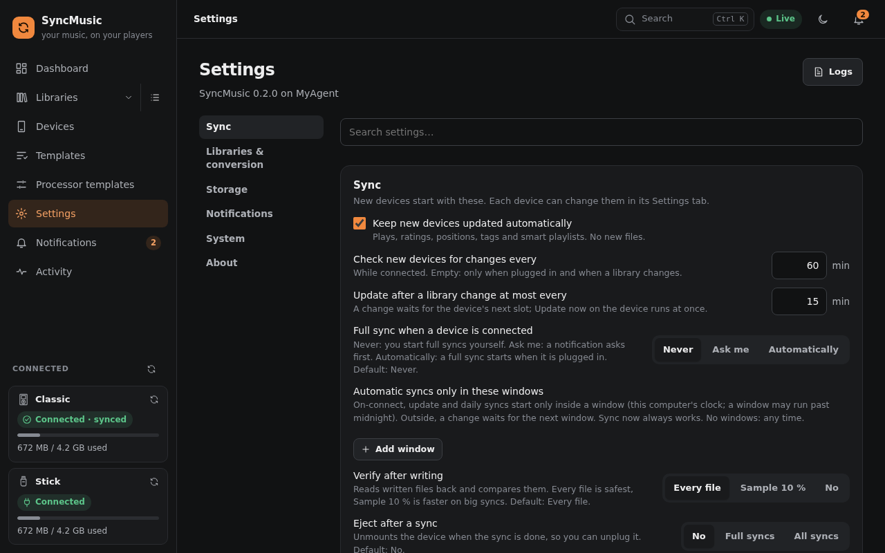
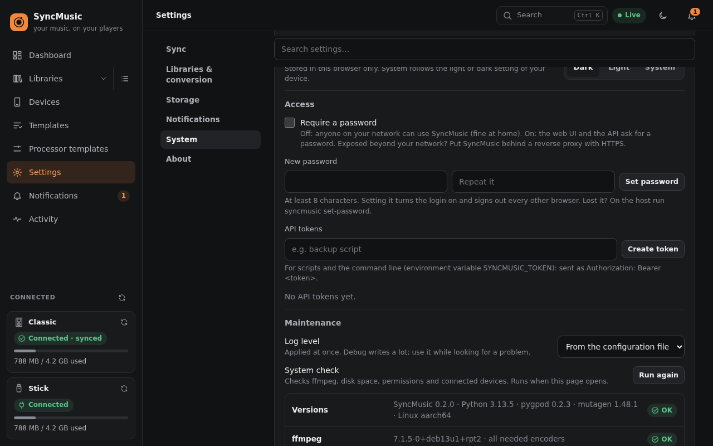
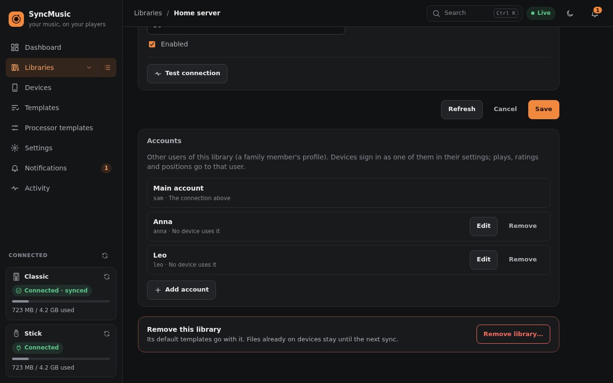

# 5. Settings reference

SyncMusic has three kinds of settings:

1. **Start-up settings** (config file, environment, command line) - where it keeps its data and how it listens;
   see [Installation → Paths and options](02-installation.md#paths-and-options). `syncmusic config init` prints
   them all with their defaults.
2. **Application settings** - *Settings* in the web interface (stored in the database).
3. **Device settings** - per device, on the device's *Settings* tab (sections *Sync behaviour* and *Device*).

The key names below are the ones the API uses (`GET/PATCH /api/v1/settings`, `/api/v1/devices/{id}`) and the ones
an export file contains.

See also the generated [Settings reference](08-settings-reference.md).

## Application settings (*Settings*)

### Sync (and Appearance under System)
What a **newly registered** device starts with; each device can change them later.

| Key | Default | Meaning |
|---|---|---|
| `default_on_connect` | `manual` | When a device is plugged in: `auto` sync, `ask` (notification), `manual` (only when you press Sync). Updates run regardless. |
| `default_update_sync` | on | Run updates while the device is connected. |
| `default_update_every_min` | 60 | Check for changes every N minutes while connected (empty: only on connect and when a library changes). |
| `default_verify` | `all` | Read back after a full sync: every file, a 10 % `sample`, or `off`. |
| `default_eject_after` | `off` | Eject after a successful sync: `off`, after a `full` sync, after `any` sync. |
| `default_no_cache` | off | Do not keep converted files in the processing cache (saves disk, converts again next time). |
| `default_no_cache_files` | 4 | No-cache mode: files waiting in memory for the device write. |
| `default_no_cache_budget_mb` | 1000 | No-cache mode: memory for those files together (MB). |
| `default_no_cache_file_max_mb` | 256 | No-cache mode: bigger files are spooled to disk instead (MB). |
| `write_limit_mb_s` | none | Write speed limit for every USB device's full sync (MB/s). |
| `db_backup_every` | daily | Automatic database backups: off, 6h, daily or weekly. One is also made before an update and before a factory reset. |
| `db_backup_keep` | 7 | How many database backups are kept. |
| `db_backup_dir` | `<data_dir>/backups` | Where the backups go (gzip; secrets stay in them as in the database). |
| `update_change_gap_min` | 15 | A library change starts a device update at most this often (minutes). |
| `max_device_syncs` | no limit | Device syncs running at the same time. |
| `concurrency` | CPUs − 1 | Conversion threads (takes effect after a restart). |
| `compas_sdtool_path` | none | *HiBy R1 with Compás*: the compas-sdtool program (empty: next to SyncMusic, then `<data_dir>/tools/`). **Check tool** shows its version and library format; **Download** fetches it from SyncMusic's release after you confirm (checksum, architecture and version are checked). compas-sdtool is part of [Compás Tools](https://github.com/Starnished66/compas-tools) (GPL-3.0); see [THIRD-PARTY.md](../THIRD-PARTY.md). |
| `clients_allowed` | off | *Wi-Fi clients*: client apps may pair with this server and sync over the network. Off: the client API refuses every request and nothing is announced. Plain HTTP: use it only on a network you trust. |
| `clients_mdns` | on | Announce the server on the local network (mDNS) while Wi-Fi clients are allowed, so apps find it without typing an address. |
| `client_code_minutes` | 10 | How long a pairing code stays valid (single use; at most three are open at once). |
| `client_poll_s` | 300 | How often a paired client asks whether a sync is due (seconds). |

### Libraries
| Key | Default | Meaning |
|---|---|---|
| `snapshot_refresh` | `sync` | When SyncMusic re-reads a library: before every `sync`, at most `hourly`, or only on `manual` *Refresh*. |

### Storage (Cache & space, Backup)
| Key | Default | Meaning |
|---|---|---|
| `cache_max_gb` | 20 | Size of the processing cache; the least recently used files are removed above it. |
| `cache_combined_books` | on | Keep combined audiobooks in the cache even for no-cache devices (they take long to build). |
| `history_days` | 90 | Sync history and reports older than this are deleted (the newest of each device is kept). |
| `log_days` | 14 | Rotated log files older than this are deleted. |
| `disk_warn_gb` | 5 | Warn when the disk with SyncMusic's data and cache has less free space (GB; empty: no warning). |

### Conversion
| Key | Default | Meaning |
|---|---|---|
| `ffmpeg_path` | from `PATH` | The ffmpeg program (ffprobe is expected next to it). |
| `convert_nice` | 10 | CPU priority of conversions (0 = normal, 19 = lowest). |

### Notifications
| Key | Default | Meaning |
|---|---|---|
| `inbox_events` | all | Which events the notification centre (bell) keeps. |
| `notification_days` | 7 | Notifications older than this are deleted (empty: kept). |
| `webhook_url` | none | Send events as JSON `POST` to this URL (e.g. ntfy, Home Assistant, Gotify). |
| `webhook_events` | connected, unknown device, sync started / needs confirmation / finished / failed, database size warning | Which events go to the webhook. |
| `quiet_hours` | none | No webhook between two times (`start`/`end`, `HH:MM`, may cross midnight). |
| `default_sync_windows` | none (any time) | Sync windows a new device starts with (see *Sync windows* below). |

### System (Maintenance, Updates, Import / export)
| Key | Default | Meaning |
|---|---|---|
| `log_level` | from the config file | `DEBUG`, `INFO` or `WARNING`, changed without a restart. |
| `auto_update` | off | Installing a new version (the single-file program and its service only): `off` - only tell you; `after_syncs` - once no sync runs (automatic syncs wait meanwhile); `now` - at once, running syncs stop and continue after the restart. A new version that does not start is replaced by the previous one again. |
| `update_channel` | `stable` | Which GitHub releases count as updates: `stable` releases only, or `beta` - also the test builds made from every change. SyncMusic checks once a day and on *Check now*; it shows the new version, what changed and the download for your kind of install (Docker: pull the new image). The configuration file's `update_repo` (default `Bionded/SyncMusic`, `none` = no checks) names the repository - or the full `https://` address of a releases list in GitHub's format, for a mirror. |

**Storage & resources** (under System) lists everything SyncMusic keeps on disk - the database, database
backups, logs, library snapshots, the media and system cache, copies of players' databases, the tags read for
*Player contents*, local copies of FTP/SMB folder libraries, temporary files and the unpacked program - each with its
size, its folder (copy button) and one action to clear it; copies of players' databases and server folders can be
deleted per device or library. Clearing asks first and says how much it frees; parts a running sync may use can only be
cleared when no job runs. The database, the configuration and anything on a device are never offered for deletion.
Below it: memory used, helper processes, CPU now and on average, uptime, threads, response delay and the in-memory caches,
refreshed every few seconds, with *Free memory now* to drop what is rebuilt on demand (a pending plan that only keeps what is already on the device is dropped too; one with changes stays). The same is available as
`GET /api/v1/system/storage` and `GET /api/v1/system/resources`.

**Backup** downloads libraries, devices, templates and settings as one file (history, listening data and the cache
are not in it); passwords and the webhook URL only when you tick *Include passwords* - then keep the file safe.
**Import / export** moves single device settings and templates between installations; passwords are never exported.
**Access** (optional login): *Require a password* (off by default) - when on, the web interface and the API ask for
it. *Set password* (at least 8 characters) turns it on and signs out every other browser; *Sign out everywhere* ends
every session (this one too). **API tokens** for scripts and the command line (environment variable
`SYNCMUSIC_TOKEN`): give a name, copy the token at once - it is not shown again - and *Revoke* it when no longer
needed. The login is not part of a backup and a restore keeps it.

**Appearance → Instance name** (`instance_name`, default empty): what this SyncMusic installation is called (empty: the host name). It is shown
under the logo and in *About*, next to the installation's id, which is made at the first start and stays the same
across updates; a fresh install gets a new one.

**Appearance → Theme**: Dark (default), Light or System (follows your device's light/dark setting). Stored in this
browser only; the sun/moon/monitor button in the top bar switches between the three as well.

## Device settings

### Settings tab - Sync behaviour
| Key | Default | Meaning |
|---|---|---|
| `on_connect` | from Settings → Sync | `auto`, `ask` or `manual` when the device is plugged in. |
| `sync_at` | none | A daily sync at this time (`HH:MM`) while the device is connected. |
| `sync_windows` | none (any time) | Automatic syncs (on connect, update syncs, the daily sync) start only inside these windows: `start`/`end` `HH:MM` (may cross midnight), `days` 0 = Monday. Outside, a change waits for the next window; Sync now always works. |
| `update_sync` | on | Updates while connected. |
| `update_every_min` | from Settings → Sync | How often updates check for changes. |
| `update_removals` | off | Updates may also remove what no rule selects any more (otherwise removals wait for a full sync). |
| `update_remove_played` | on | …but items played, finished or rated on the device are removed by updates too. |
| `remove_deleted` | on | Items deleted from their library are removed from the device. |
| `delete_threshold_pct` | 20 | A sync that would remove more than this share of the device asks first. |
| `rating_priority` | `device` | When device and library ratings differ, which one wins. |
| `verify` | `all` | Read back after a full sync: `all`, `sample` or `off`. |
| `eject_after` | `off` | Eject after a successful `full` or `any` sync. |
| `combine_audiobooks` | on for iPods | A multi-file audiobook becomes one `.m4b` with chapters. |
| `playlist_conflicts` | `ask` | A playlist changed on both sides, or a player playlist named like a library one: `ask`, `merge`, `replace` (device wins), `ignore` (library wins), `rename`. |
| `backup_device_db` | off | Keep a copy of the device's database before each sync. |
| `backup_keep` | 5 | How many of those copies to keep. |
| `safety_margin_pct` | 1 | Space left free on the device (percent of its size)… |
| `safety_margin_min_bytes` | 100 MB | …at least this much… |
| `safety_margin_max_bytes` | 500 MB | …and at most this much (the minimum wins if larger). |
| `no_cache` | from Settings → Sync | No-cache mode for this device (see above). |
| `no_cache_files`, `no_cache_budget_mb`, `no_cache_file_max_mb` | 4, 1000, 256 | Its memory limits. |
| `gentle_write` | off | Gentle write mode: write in batches with pauses. |
| `unmount_foreign` | off | Unmount other programs' mounts of the player (a system automount) during the first minute after SyncMusic mounted it. |
| `gentle_batch_files` | 25 | Files per batch. |
| `gentle_pause_s` | 2 | Pause after each batch (seconds). |
| `gentle_rate_mb_s` | none | Write speed limit in gentle mode (MB/s). |

### Reverse sync
| Key | Default | Meaning |
|---|---|---|
| `enabled` | on | Read listening data back before every sync. |
| `plays` | on | Play counts and last played. |
| `ratings` | on | Ratings and favourites. |
| `positions` | on | Audiobook and podcast positions. |
| `playlists` | on | Playlists changed on the player go back to the library. |

### Library accounts
A family member's player can use **their own** profile on a shared Navidrome, Jellyfin or Audiobookshelf.
First add the user to the library: *Libraries → (library) → Edit → Accounts → **Add account***, with a display name
and their user name and password (Navidrome, Jellyfin), or API token (Audiobookshelf); **Test** signs
in without saving. Then pick the account in the device's *Library accounts* dropdown (or choose **+ Add account…**
there to add one without leaving the page). The device then plans from that user's ratings, stars, play counts and
positions, and everything the reverse sync sends back lands on that user; devices of the same user share one
library index. (Jellyfin sends nothing back: its account only picks whose library is read.) The library itself and other devices keep the main account; the plan shows "Signed in as: …".
An account a device uses cannot be removed - the library page says which devices use it. Folder libraries have
no users, so they are not listed. Stored secrets show as `********`; leaving the mask keeps them.

To see what another user has, choose them under **View as** in the library browser, in the template editor's
preview and in *Pick from library* (the device's *Library accounts* card links to the browser as its account).
A template used by devices that sign in as different users says so, and a plan warns about picks or playlists the
device user's library does not have ("… not in Anna's library").

### Settings tab - Device
Depends on the device type: e.g. the time zone and clock setting of an iPod, the folder layout, formats, ASCII-only
names and lyrics mode of a USB drive, the playlist folder and play thresholds of a Rockbox player, address and login
of an FTP/SMB device. Each field is explained next to it in the interface.
