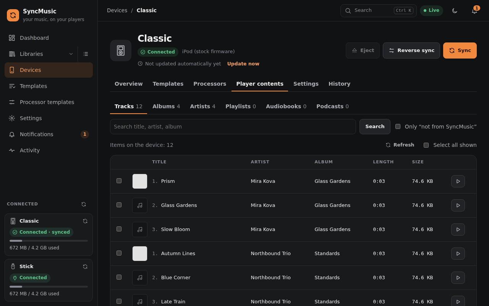

# 6. Troubleshooting and FAQ

**Reporting a bug:** attach the zip from *Settings → System → Collect diagnostics* (or `syncmusic diagnostics`); secrets are masked.

**First stop:** `syncmusic doctor` (or *Settings → System → System check*) checks the install and says how to fix each problem. The device page shows the last error, *Device → History* shows every job with its log and report, and
`syncmusic logs` (or `journalctl -u syncmusic -f` for the service) shows the application log. *Settings →
System* switches the log to `DEBUG` without a restart.

## The device does not appear
- Run `lsblk -o NAME,TRAN,RM,SERIAL,FSTYPE,MOUNTPOINTS`: the player must be listed with `TRAN` = `usb`.
- `http://<host>:8765/api/v1/devices/diagnostics` lists every disk the system sees and **why** it is used or ignored,
  whether hot-plug detection works and which privileges SyncMusic has (`root`, `sudo`, `helper` or `none`).
- In Docker, only the **usb** variant sees USB devices.
- After a **Format** the file system ID changes; the device is still recognised by its USB serial.

## "Guard refused"
SyncMusic only writes to disks that are connected over **USB** and are removable or a known iPod, and never to a disk
that holds a system mount or swap (or, if you configured an allowlist, a disk not on it). This is deliberate and
cannot be switched off.

## The player shows old content after a sync
- **HiBy R1:** reboot the player after the sync.
- **Rockbox:** let it update its database (*Database → Initialize now* on the player if it does not do it by itself).
- **iPod:** always eject with SyncMusic's **Eject** before unplugging, so the database is written completely.

## The file system is damaged
When reading or writing fails with a file system error, the device page shows a banner and automatic syncs stop.
**Check and repair** runs `fsck` on the data partition only (never on an iPod's firmware) and mounts it again; the
next sync rewrites any file that was cut off. If the errors come back, the player's storage is failing.

An **NTFS** drive unplugged without *Eject* may not mount ("volume is dirty"): repair it in Windows (`chkdsk /f`) or
format it.

## "Also mounted by another program" / "unmount it first"
Some systems mount every USB drive they see on their own (Umbrel's external storage, a desktop's automount through
udisks or GNOME, `usbmount`). The player is then mounted twice: once by SyncMusic and once by the system. Check and
repair, Format and Wipe need the partition unmounted everywhere, so Check and repair offers **Unmount everywhere and
continue**. The same action is in the device's **Settings → Danger zone → Unmount everywhere**: it lists every
mountpoint, flushes pending writes and unmounts them all. If a program still has files open there, SyncMusic names
it (`name (process id)`); close it, or choose **Detach anyway**, which removes the mount at once and releases the
file system when that program lets go.

The device page shows **Also mounted by the system** while such a mount exists. Two programs writing to one FAT volume
at the same time can damage it. The device setting **Unmount other mounts when connected** (Sync → Advanced, off by
default) removes other programs' mounts during the first minute after SyncMusic mounted the player. Better still, turn
the system's automount off for your players: on Umbrel unmount or ignore the drive under external storage, on a desktop disable
"mount removable drives automatically" (or a udisks rule with `UDISKS_AUTO=0` / `UDISKS_IGNORE=1`), and remove
`usbmount` if it is installed. Over the API: `GET /api/v1/devices/{id}/mounts` and
`POST /api/v1/devices/{id}/unmount-all` (`?lazy=true` to detach busy mounts).

## It does not fit
The plan shows the space after the sync. Choose what to leave off in the plan, add limits to your rules (*At most*
… GB or tracks), convert to a smaller format (e.g. AAC 256 instead of ALAC) or pick fewer templates. SyncMusic always
keeps a small safety margin free (device *Settings* tab).

## Orphans
Files on the device whose source is gone from its library (or whose library was removed or disabled) are **orphans**.
By default items deleted from their library are removed by the next sync; others stay until you remove them on
*Player contents → Orphans*.

## The sync stopped with "unmounted during the sync"
The disk went away (cable, power, or a desktop automounter unmounted it). Plug it in again and sync: the next plan
continues where it stopped.

## Slow or hanging writes
Turn on **gentle write mode** (device *Settings* tab) for players with tired disks or cheap SD/CF adapters, and use a
direct USB port instead of a hub.

## "Storage may be failing"

The dashboard and the device's **Storage health** card warn when a sync or an integrity check hit an I/O error in
the last 30 days, or when the last full sync wrote at less than half its usual speed. The card lists the recorded
errors (when, which file or operation). Copy what you need, run an integrity check, and try gentle write mode.
**Acknowledge** (on the dashboard row or the card) hides the warning until a newer error or slow sync happens.
After you replaced or reformatted the storage, **Clear error history** in the card forgets the old errors (write
speeds are kept); a Format offers the same.

## "Unknown device type"

The device was registered with a device type this version of SyncMusic does not know (it was renamed or removed, or the
entry is damaged). Its page shows only this message and **Delete**: remove the device and register the player again.

## Running out of disk space on the computer
The processing cache keeps converted files (*Settings → Storage*, 20 GB by default). Lower the limit, or turn
on **no-cache mode** for a device. SyncMusic warns when the disk gets low (`disk_warn_gb`).

## The desktop window does not open
Install `libsecret-1-0 libegl1 libgl1 libgles2` and a Chromium-based browser; a display is required. The web flavour
works without any of it.

## Reporting a problem
Note what you did and what happened, then attach the job's report (*History → Open report*) and the application log.
Remove addresses and user names you do not want to share.
