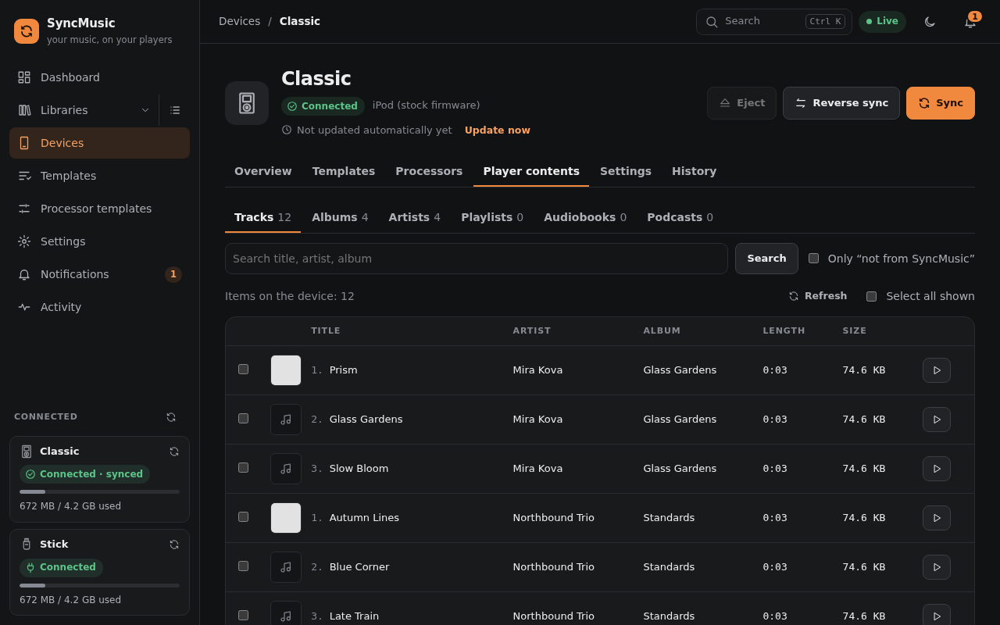

# 6. Troubleshooting and FAQ

**Reporting a bug:** attach the zip from *Settings → Maintenance → Collect diagnostics* (or `syncmusic diagnostics`); secrets are masked.

**First stop:** `syncmusic doctor` (or *Settings → Maintenance → System check*) checks the install and says how to fix each problem. The device page shows the last error, *Device → History* shows every job with its log and report, and
`syncmusic logs` (or `journalctl -u syncmusic -f` for the service) shows the application log. *Settings →
System* switches the log to `DEBUG` without a restart.

## The device does not appear
- Run `lsblk -o NAME,TRAN,RM,SERIAL,FSTYPE,MOUNTPOINTS`: the player must be listed with `TRAN` = `usb`.
- `http://<host>:8765/api/v1/devices/diagnostics` lists every disk the system sees and **why** it is used or ignored,
  whether hot-plug detection works and which privileges SyncMusic has (`root`, `sudo`, `helper` or `none`).
- In Docker, only the **usb** variant sees USB devices.
- After a **Format** the file system ID changes; the device is still recognised by its USB serial.

## "Guard refused"
SyncMusic only writes to disks that are connected over **USB** and are removable or a known iPod (or a fixed USB disk -
a USB SSD or hard-disk enclosure - that you registered as a device), and never to a disk
that holds a system mount or swap (or, if you configured an allowlist, a disk not on it). This is deliberate and
cannot be switched off.

## The player shows old content after a sync
- **HiBy R1:** reboot the player after the sync.
- **Rockbox:** let it update its database (*Database → Initialize now* on the player if it does not do it by itself).
- **iPod:** always eject with SyncMusic's **Eject** before unplugging, so the database is written completely.

## The file system is damaged
When reading or writing fails with a file system error, the device page shows a banner and automatic syncs stop.
If a sync stopped that way, SyncMusic repairs the file system and continues the sync by itself, once. **Repair and
continue** does the same on demand: it runs `fsck` on the data partition only (never on an iPod's firmware), mounts
it again and syncs again, continuing from the last checkpoint (files written before it are kept, a file that was cut
off is written again). If the error comes back soon after a repair, the device page says the storage may be
failing: check the system log for disk errors, try another card or cable, or turn on gentle writing. When the error
stopped at the same file, **Skip that file and continue** leaves that file out of the syncs for a day, repairs the
file system and continues with the rest.

An **NTFS** drive unplugged without *Eject* may not mount ("volume is dirty"): repair it in Windows (`chkdsk /f`) or
format it.

## "Sync records damaged"
SyncMusic keeps a list of what it put on a player (`.syncmusic/manifest.jsonl`) and a second copy next to it. If both
cannot be read, the device page shows *Sync records damaged*. **Rebuild from files** moves both copies aside
(`*.damaged`) and the next sync starts as a first sync: choose **Adopt** to take over the files that match your
libraries by path and tags, so nothing is copied again. Wiping the device is the other way out. Players reached over
the network or MTP cannot be rebuilt this way.

## Check and repair the file system
Every USB player has **Settings → Danger zone → Check and repair file system**: it unmounts the player and runs the
file system check (FAT/exFAT; only the data partition, never the partition table or an iPod's firmware), fixing
what it finds. When something went wrong - Eject failed, the check right after unmounting found errors, the file
system is damaged - the same **Check and repair** button appears at the top of the device page, next to Eject and
Sync, on every tab. Files the repair had to cut short are written again by the next sync; run an integrity check
afterwards to see them.

## "Also mounted by another program" / "unmount it first"
Some systems mount every USB drive they see on their own (Umbrel's external storage, a desktop's automount through
udisks or GNOME, `usbmount`). The player is then mounted twice: once by SyncMusic and once by the system. Check and
repair, Format and Wipe need the partition unmounted everywhere, so Check and repair offers **Unmount everywhere and
continue**. The same action is in the device's **Settings → Danger zone → Unmount everywhere**: it lists every
mountpoint, flushes pending writes and unmounts them all. If a program still has files open there, SyncMusic names
it (`name (process id)`); close it, or choose **Detach anyway**, which removes the mount at once and releases the
file system when that program lets go.

The device page shows **Also mounted by the system** while such a mount exists; **Make read-only** there turns the other mounts read-only (the system can still read the player, only SyncMusic writes), and the device setting *Make other mounts read-only when connected* does it every time. Copies of SyncMusic's own mount that a container or the system shows under another path (Umbrel shows it again under `/mnt/root/…`) are not counted as other mounts. Two programs writing to one FAT volume
at the same time can damage it. The device setting **Unmount other mounts when connected** (Sync → Advanced, off by
default) removes other programs' mounts during the first minute after SyncMusic mounted the player. Better still, turn
the system's automount off for your players: on Umbrel unmount or ignore the drive under external storage, on a desktop disable
"mount removable drives automatically" (or a udisks rule with `UDISKS_AUTO=0` / `UDISKS_IGNORE=1`), and remove
`usbmount` if it is installed. Over the API: `GET /api/v1/devices/{id}/mounts` and
`POST /api/v1/devices/{id}/unmount-all` (`?lazy=true` to detach busy mounts).

SyncMusic itself never mounts a player a second time. If another program mounted it first (also through FUSE:
exfat-fuse, ntfs-3g), SyncMusic writes through that mount (**Use an existing mount**, on by default) or, with that
setting off, refuses with "mounted by another program". A read-only mount by another program is refused for syncs.
If a second mount appears while SyncMusic is writing (an automounter that came late), the sync stops before its next
write with "mounted a second time by another program"; unmount the other mount, then sync again.

## It does not fit
The plan shows the space after the sync. Choose what to leave off in the plan, add limits to your rules (*At most*
… GB or tracks), convert to a smaller format (e.g. AAC 256 instead of ALAC) or pick fewer templates. SyncMusic always
keeps a small safety margin free (device *Settings* tab).

## Orphans
Files on the device whose source is gone from its library (or whose library was removed or disabled) are **orphans**.
By default items deleted from their library are removed by the next sync; others stay until you remove them on
*Player contents → Orphans*.

When a library server was reinstalled or its library re-created, the same files come back under new ids. SyncMusic
re-links the items on the device to them (same title, artist, album, track number and length) instead of copying them
again; the plan says "re-linked N items", and listening data read from the device goes to the new ids. Items that
fit more than one library item are left as orphans.

## The sync stopped with "unmounted during the sync"
The disk went away (cable, power, or a desktop automounter unmounted it). Plug it in again and sync: the next plan
continues where it stopped.

## Slow or hanging writes
Turn on **gentle write mode** (device *Settings* tab) for players with tired disks or cheap SD/CF adapters, and use a
direct USB port instead of a hub.

iPods with a CF or SD card adapter under Rockbox: if a sync with conversion fails with an I/O error after a pause
and the player stops answering every write (the system log shows `MEDIUM ERROR` / `WRITE ERROR` after a 180 s
timeout), the adapter fell into standby and never woke up. Unplug and replug the player (or reboot it), then sync
again. The real fix is on the player: under Rockbox raise **Settings → General Settings → System → Disk → Disk
Spindown** to the maximum. For players that cannot, turn on gentle write mode and its option **Keep the disk awake
during pauses** (device *Settings* tab): while the sync waits for a conversion, a library or a pause between
batches, a few bytes are read from the disk every 2 seconds (adjustable), so it is never idle long enough to fall
asleep. It only reads, nothing is written.

## "Storage may be failing"

The dashboard and the device's **Storage health** card warn when a sync or an integrity check hit an I/O error in
the last 30 days, or when the last full sync wrote at less than half its usual speed. The card lists the recorded
errors (when, which file or operation). Copy what you need, run an integrity check, and try gentle write mode.
**Acknowledge** (on the dashboard row or the card) hides the warning until a newer error or slow sync happens.
After you replaced or reformatted the storage, **Clear error history** in the card forgets the old errors (write
speeds are kept); a Format offers the same.

The integrity check comes in three kinds: **Quick** (default) compares sizes and finds missing files and files from
other programs in seconds; **Full** reads every file back; **Deep** also decodes each one. The card shows how much
a full check reads and, once SyncMusic knows the device's speed, about how long it takes. Every check can be
cancelled at any point; a cancelled check keeps what it found so far.

## "Unknown device type"

The device was registered with a device type this version of SyncMusic does not know (it was renamed or removed, or the
entry is damaged). Its page shows only this message and **Delete**: remove the device and register the player again.

## Running out of disk space on the computer
The processing cache keeps converted files (*Settings → Storage & backups*, 20 GB by default). Lower the limit, or turn
on **no-cache mode** for a device. SyncMusic warns when the disk gets low (`disk_warn_gb`).

## The desktop window does not open
Install `libsecret-1-0 libegl1 libgl1 libgles2` and a Chromium-based browser; a display is required. The web flavour
works without any of it.

## Reporting a problem
Note what you did and what happened, then attach the job's report (*History → Open report*) and the application log.
Remove addresses and user names you do not want to share.
