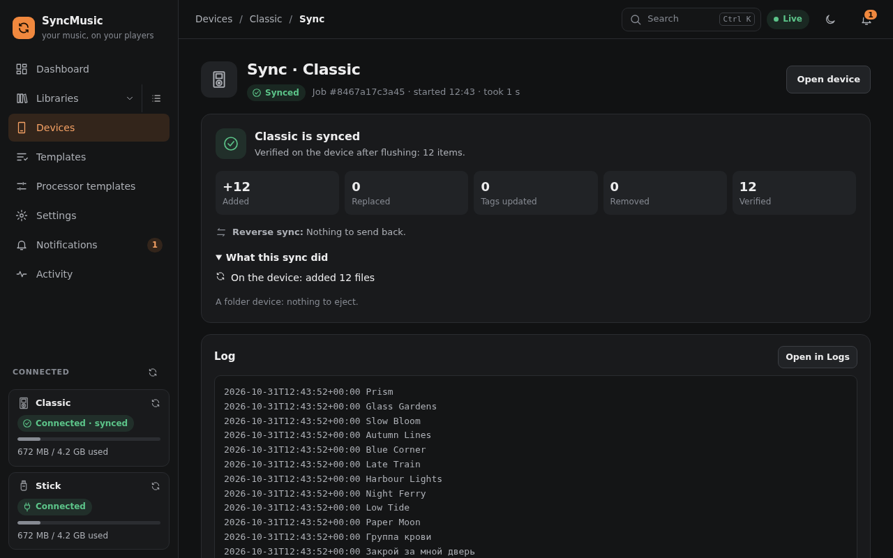

# 7. Command line and API reference

## Command line
The same `syncmusic` program starts the service and talks to a running one. Every command has `--help` with
examples; the commands that talk to a running instance take `--url` (default: from the config, e.g.
`http://127.0.0.1:8765`) and most take `--json` for machine-readable output.

### Starting and stopping
| Command | What it does |
|---|---|
| `syncmusic` / `syncmusic run` | Start in the foreground (web, desktop or daemon mode: `--mode`). |
| `syncmusic -d` | Start in the background (pid and log file in the data dir). |
| `syncmusic stop` | Stop the background instance. |
| `syncmusic status` | Health of the running instance and its devices. |
| `syncmusic doctor [--json]` | Check the install (ffmpeg, space, folders, device access, udev, clock, port, libraries) with a fix per problem; exit code 1 on a failure. |
| `sudo syncmusic --install [--user NAME]` / `--uninstall [--purge]` | Install or remove the systemd service. |
| `syncmusic update [--check] [--channel stable\|beta] [--now]` | Look for a newer release and install it into the running instance (single-file program and its service; waits for running syncs unless `--now`). |
| `syncmusic config init [--output FILE] [--force]` | Write a commented default config file. |

Path options for `run`, `-d` and `--install`: `--config`, `--host`, `--port`, `--data-dir`, `--cache-dir`,
`--log-dir`, `--mount-root` (see [Installation](02-installation.md#paths-and-options)).

### Working with a running instance
| Command | What it does |
|---|---|
| `syncmusic sync DEVICE [--plan-only] [--yes] [--first-sync keep\|adopt\|wipe] [--force]` | Plan, confirm and apply a sync, then follow the job. `--force` trims the plan to what fits. |
| `syncmusic jobs` | Recent jobs. |
| `syncmusic set-password [--password P]` | Set the login password and turn the login on (asks when `--password` is left out); works on the database directly, also to recover a lost password. |
| `syncmusic logs [-n LINES] [--job ID]` | Tail of the application log, or one job's log. |
| `syncmusic libraries list\|add\|check\|refresh` | Libraries: list, add (or replace), check reachability, reload. |
| `syncmusic devices list\|register\|eject\|format\|rename\|allowlist` | Devices; `format` needs `--confirm <device name>`; `allowlist` writes the hardware tests' `tests/hardware.toml` for registered players. |
| `syncmusic rules validate FILE` / `rules test DEVICE` | Check a rule file; show what a device's rules select. |
| `syncmusic templates list\|show\|apply` | Rule templates; `apply TEMPLATE DEVICE` links one to a device. |

Examples:

```sh
syncmusic sync my-ipod --plan-only           # what would happen
syncmusic sync stick --yes --first-sync adopt
syncmusic templates apply music-all my-ipod
syncmusic logs -n 200
```



## REST API
Everything the web interface does goes through the REST API under `/api/v1/`. A running instance documents it
itself:

- `http://<host>:8765/docs` - interactive documentation (Swagger UI),
- `http://<host>:8765/redoc` - the same as a reference page,
- `http://<host>:8765/openapi.json` - the OpenAPI schema.

Useful entry points: `GET /api/v1/health`, `GET /api/v1/devices`, `POST /api/v1/devices/{id}/plan`,
`GET /api/v1/jobs`, `GET /api/v1/settings`. Live events (progress, device plugged in) come as a server-sent event
stream (`GET /api/v1/events?types=job.,sync.`).

By default the API has **no authentication**. With the optional login on (*Settings → System → Access*) every
request needs the session cookie of a login or an API token: `curl -H "Authorization: Bearer $SYNCMUSIC_TOKEN" …`;
the `syncmusic` commands send `SYNCMUSIC_TOKEN` by themselves. See [Installation → Security](02-installation.md#security).
