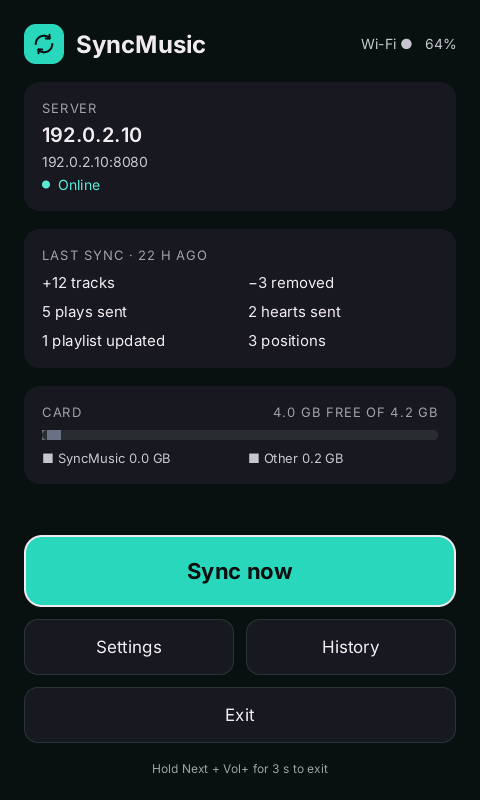
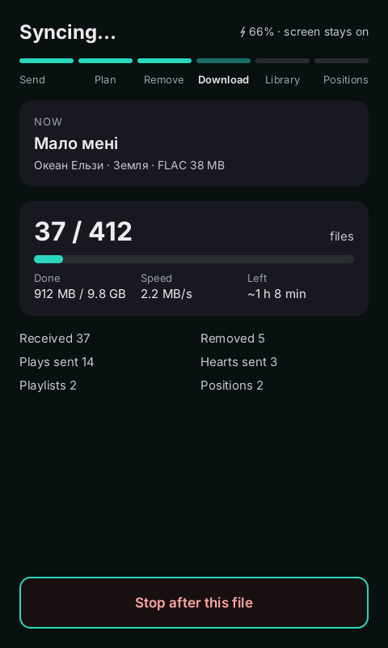
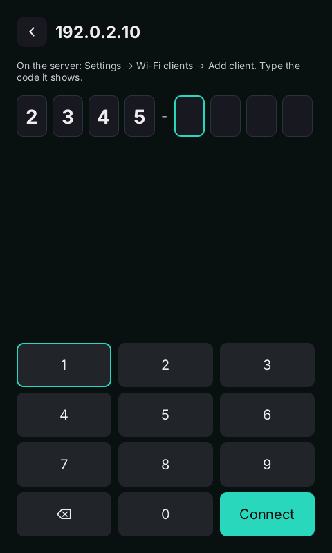
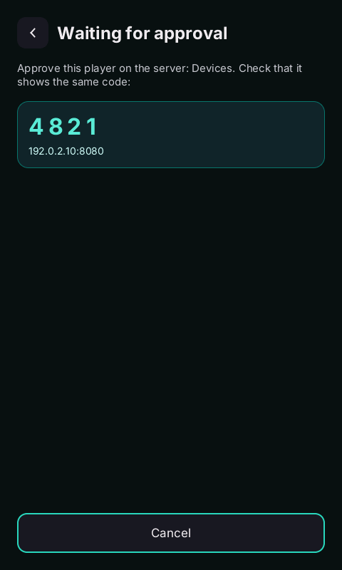
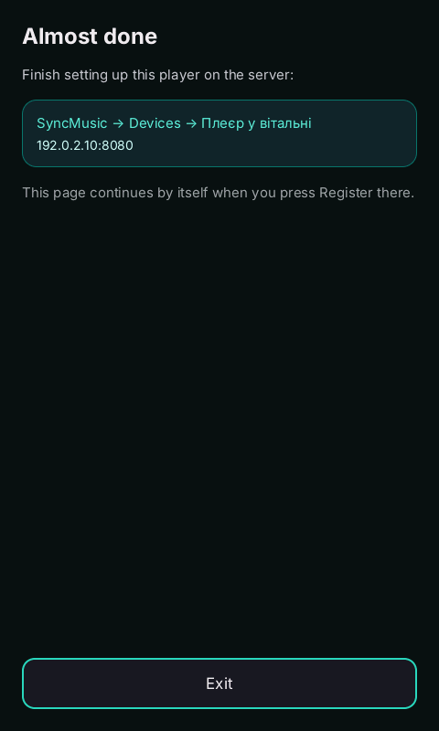
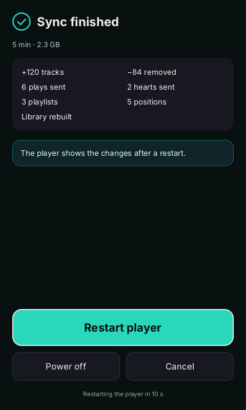

# SyncMusic app for Compás players

The SyncMusic app runs on a HiBy R1 with the Compás firmware and syncs the player with your SyncMusic server
over Wi-Fi. A sync does the same as a sync over USB: it brings music, audiobooks, podcasts and playlists onto the
SD card, removes what you no longer picked, and sends plays, star ratings, positions and playlist edits back.
Star ratings follow the same rules as over USB (see *Devices → HiBy R1 with Compás*): your stars become the song's rating
in your library, your library's ratings show on the player, and a favourite without a rating shows as 5 stars.
Album stars sync the same way with Navidrome and other Subsonic servers.
A large first sync comes in parts: the server prepares a few GB at a time and the app goes on with the next part
by itself until everything is on the card.

 

## What you need
- A HiBy R1 with Compás and its external apps support (the *Apps* screen).
- Wi-Fi on the player and on the same network as the SyncMusic server.
- On the server: **Settings → Wi-Fi clients → Allow Wi-Fi clients**. Keep **Announce on the network** on so the
  app finds the server by itself. For music that shows right after a sync, the server needs compas-sdtool (see
  [HiBy R1 (Compás)](04-devices.md#hiby-r1-compás)); without it the player indexes the new files itself.

## Install
1. Download the app from the [latest release](https://github.com/Bionded/SyncMusic/releases/latest) (next to the
   server downloads). There are two builds of it:
   - `syncmusic-compas-<version>-hard.zip` — **use this one**: it uses the player's floating-point unit and draws faster;
   - `syncmusic-compas-<version>-soft.zip` — the fallback: if the hard-float app closes at once or does not start
     on your player, use this one instead.
2. Connect the player by USB (storage mode) and unzip the file into the `.apps/` folder of the SD card, so that
   the card has `.apps/syncmusic/`. Eject and unplug the player.

   Both builds are the same app (same pairing and data): to switch, replace the `.apps/syncmusic/` folder with the
   other zip's folder. Updates from your server keep the build the player runs.
3. Open *Apps* on the player and start **SyncMusic**. If the player says *Could not start the app* right after
   the copy, restart the player and try again. Compás asks once to approve the app; it asks again after
   each update of the app, because the program file changed.

### Updates
The app can update itself from your server. In **Settings → Devices → Compás app updates**, **Download newest**
fetches the newest app (both builds) from SyncMusic's release on GitHub after you confirm (its checksum is checked). Or put the new `syncmusic-compas-<version>-hard.zip` and/or `-soft.zip` (unchanged, as
downloaded) into the `tools/` folder of the server's data directory, or next to the `syncmusic` program. The next
time the app opens and reaches the server, it asks: *The server has SyncMusic app X, this player runs Y. Update
now?* **Update** installs it; **Later** keeps your version (the home page keeps an **Update the app to …** button)
and the app asks again the next time it starts. Nothing is installed without your press. The device page shows the
version the player runs and whether the update was offered, declined or accepted. If the player's app is newer
than the server's, the home page says so: update the SyncMusic server, the app never installs an older version. The app
downloads and checks every file first and replaces its program file last, so an interrupted update leaves a
working app. The new version starts the next time you open SyncMusic; Compás asks once to approve it.

## Buttons
- **Volume up / volume down** (or previous / next) move the selection, **play** selects (on press). Tapping a button works too; swipe up or down to scroll a long page (Settings, History).
- **Exit** on the home page closes the app; every other page has a back key (‹, top left) or Exit / Cancel.
- **Forced exit:** hold next or previous + volume up together for 3 seconds (volume up + volume down also works on players that can report both keys at once). A running sync stops at a safe point
  first: the player's library database is never left half installed.
- **Power** (short press) switches the screen off, and on again, like in the player; a sync goes on with the screen
  off. Holding Power still powers the player off.
- When the screen is dimmed or off, the first press only wakes it (the touch screen is off while the screen is).
- With the screen off the app stays connected to Wi-Fi, so a sync started from the server still arrives: it only
  turns the backlight off and keeps the player awake while the app is open. That costs a little more battery than
  the player's own screen off; close the app when you do not need it.

## Pairing
The first start shows **Not paired yet**.

- **Find servers on the network** lists the SyncMusic servers that announce themselves (a `*` means a pairing
  code is open on that server). Pick yours.
- **Enter the address** opens a keyboard for the server's address, for example `http://192.0.2.20:8080`.

Then choose how to connect. The player asks as *HiBy R1 - Compás*; you give it its name on the server, in the
request card or in the setup that opens after **Approve**. The app shows that name and takes every later rename on
the device page (Settings → **Name** on the player only shows it).

- **Connect without a code**: the server shows *Players that want to connect* at the top of the **Devices** page
  (with a count on the Devices menu item and a notice on every other page). Check that the code there is the one the player shows (you can change the player's name in the request), then **Approve**. The player
  continues by itself. **Reject** turns it down. A request is valid as long as a pairing code would be (1 minute
  by default); the server setting **Allow pairing requests** turns this way off.
- **Enter a pairing code**: on the server, **Settings → Wi-Fi clients → Add client** shows an 8-digit code (valid
  for a minute); type it on the player's number pad.

  

After pairing, the server opens the player's setup (the same steps as registering a USB player: name, what it
gets, processors); meanwhile the player shows *Finish setting up this player on the server* and continues by itself
when you press **Register**. If you leave the setup, the Devices page offers **Finish setup** for the player.

**Settings → Server → Forget this server** on the player removes the
pairing; the music on the card stays. (Writing `<server address> <code>` into `.apps-data/syncmusic/pair.txt`
over USB also pairs the app on its next start.)

## Syncing
**Sync now** on the home screen asks the server what to do and shows it first: new or changed files and their
size, files to remove, playlists, what did not fit on the card by priority, and a warning when the card has less
free space than the download needs. **Start** goes ahead, **Cancel** leaves everything as it is. A sync that has
nothing to fetch or remove starts without asking.

**Sync now** on the player's page in the web UI starts the sync in the app: while the app is open on its home
screen, the sync starts there within a second; otherwise the device page says *Waiting for the player* until you
open the app (Compás runs apps only in the foreground, so nothing can start while the app is closed). Nothing is
prepared on the server before the app asks.
The player's page also shows what waits for it on the server (*Waiting on the server*); **Clear** deletes those
prepared files, and the next sync prepares again what the player still needs.

When the sync removes more than the device's delete threshold or does not fit, the server holds it for a
confirmation. With the device setting **The player may confirm a sync** (on by default) the preview says why
and **Confirm and start** confirms it on the player; otherwise confirm it in the web UI (the app waits). A first
sync onto a card that already holds SyncMusic files is always confirmed in the web UI.

The sync screen shows the step (sending listening data, asking the
server, removing, downloading, updating the player's library, writing ratings and positions), the current file,
files and megabytes done, the speed and the time left, and what went up and down; the summary gives the average speed. **Stop after this file** ends the sync at a safe
point; the next sync continues where it stopped.

The home screen shows the server and whether it is online, what the last sync did, and the card's free space
with how much of it SyncMusic uses. **Settings** and **History** (the last 10 syncs) sit under **Sync now**. The screen stays on during a sync (setting below), and the app keeps working while the player is on a charger
(with a charge-only cable; in USB storage mode the player does not start apps). The firmware's charge limit is not
changed.

### After the sync
Compás shows new and removed files, and the ratings and play counts from your library, only after a restart: it
reloads its library database and rescans the card when it starts. When a sync changed something, the app asks:

- **Restart player** (recommended),
- **Power off**,
- **Exit**: the player shows the changes after its next restart.

The app's setting **After sync** can do this without asking (restart or power off after a 5 second countdown;
**Cancel** stops it), or do nothing. A sync that changed nothing just shows its summary.

## Settings on the player
| Setting | Default | What it does |
|---|---|---|
| Dim after | 30 s | without a button press or tap; *never* turns dimming off |
| Dimmed to | 20 % | of the normal brightness |
| Turn off after | 2 min | counted from the last press, like dimming |
| After sync | Ask | ask / restart the player / power off / do nothing (only after a sync that changed something) |
| Stay on while syncing | yes | the screen never dims or switches off while a sync runs |
| Min. battery (not charging) | 20 % | a sync does not start below it (ignored on a charger); a running sync stops at the next safe point below 10 % |
| Sync when the app opens | no | starts a sync right away (without the preview, unless the server asks for a confirmation) |
| What to sync | | the server's templates with on/off: select one to switch it (they are edited in the web UI) |
| Name | | the player's name on the server; renaming the device on the server changes it here too (the server's name wins) |
| Server | | change or forget the server |
| About | | app version, server, device id, where the log is; *History* lists the last 10 syncs; *Send diagnostics* uploads the log to the server |
| Exit the app | | closes the app |

## Audiobooks, podcasts and playlists
Audiobooks and podcast episodes go into the folders of the player's Audiobooks and Podcasts plugins, and their
positions go both ways like over USB (see [HiBy R1 (Compás)](04-devices.md#hiby-r1-compás)). Playlists from your
library come down as `.m3u` files; a playlist you make or change on the player goes back to the library with the
next sync (Navidrome smart playlists excepted).

## Troubleshooting
- **Wi-Fi is off** at start: the app offers **Turn Wi-Fi on** (it uses the player's own Wi-Fi switch). If the player
  cannot be switched from the app, turn Wi-Fi on in the player's *Settings → Wi-Fi* and start the app again.
- **No server answered**: check that both are on the same network, that **Allow Wi-Fi clients** and **Announce on
  the network** are on, or enter the address by hand. Some routers block the announcements between Wi-Fi and wired
  devices.
- **Nothing chosen yet**: the server has no templates for this player yet; add them on its device page.
- **The library could not be loaded / Library recovered** after a restart: sync again; the app reinstalls the
  library database when any of its files is missing. Send `.apps/.last-session.log` (and `.apps-data/syncmusic/startup.log`, which records each start step even when the app closes before its first screen) from the card with a bug report, or use **About → Send diagnostics**: the server keeps the app's log and a summary (never the token) and offers it on the player's device page under *Diagnostics*.
- **The request was rejected / expired**: ask again, or use a pairing code.

## Uninstall
Connect the player by USB and delete `.apps/syncmusic/` and `.apps-data/syncmusic/`. The synced music stays on the
card; remove it with the server (unlink the templates and sync) before you uninstall, or delete the folders by hand.
On the server, **Revoke** the client under **Settings → Wi-Fi clients**.
