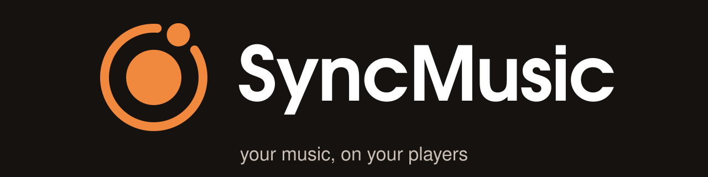

# SyncMusic user guide

SyncMusic copies music, podcasts and audiobooks from your media server onto portable players and brings what you
listened to back. This guide is for people who use SyncMusic; developer notes are in `dev/`.

1. [Overview and concepts](01-overview.md) - libraries, devices, templates and rules, processors, reverse sync
2. [Installation](02-installation.md) - single-file binary, systemd service, Docker, upgrading
3. [First run walkthrough](03-first-run.md) - library, device, templates and rules, processors, plan, sync
4. [Device guides](04-devices.md) - iPod, Rockbox, HiBy R1, USB drive, FTP/SMB
5. [Settings reference](05-settings.md) - every application and device setting with its default
6. [Troubleshooting and FAQ](06-troubleshooting.md)
7. [Command line and API reference](07-cli-api.md)
8. [Settings reference](08-settings-reference.md) - every setting with its explanation (generated)
9. [Recipes](09-recipes.md) - rotating a changing selection of music

For contributors: [architecture](dev/architecture.md), [add a device](dev/add-a-device.md),
[add a library](dev/add-a-library.md), [add a processor](dev/add-a-processor.md), the
[Wi-Fi client protocol](dev/client-protocol.md) for client app authors and
[CONTRIBUTING](../CONTRIBUTING.md).

SyncMusic 0.2.0 is the first stable release. See the [changelog](../CHANGELOG.md) for known limitations.
